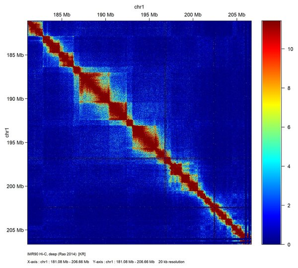
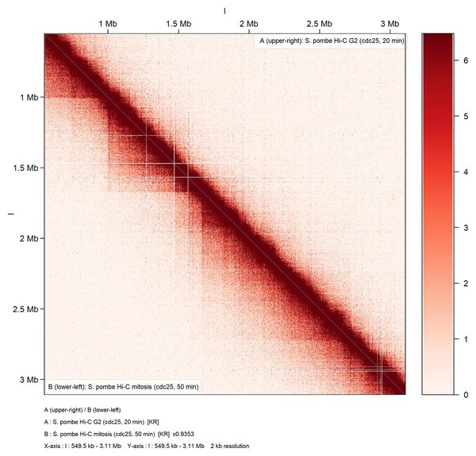
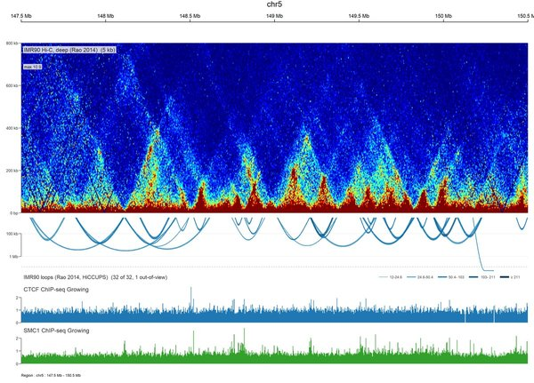
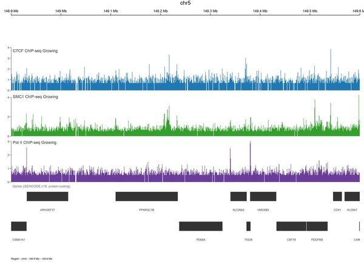
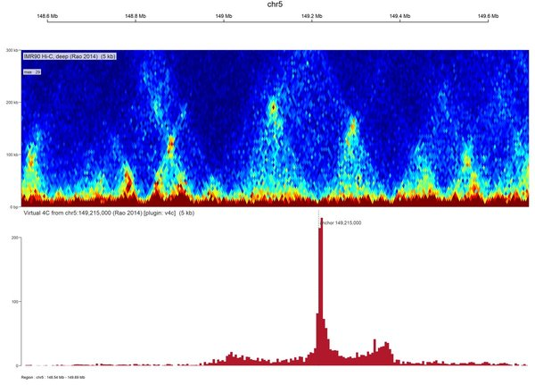
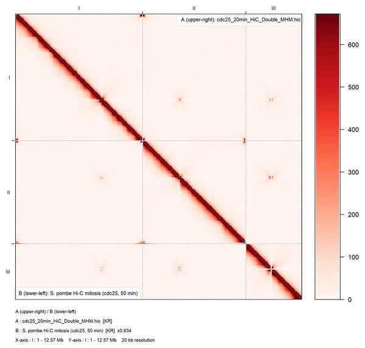
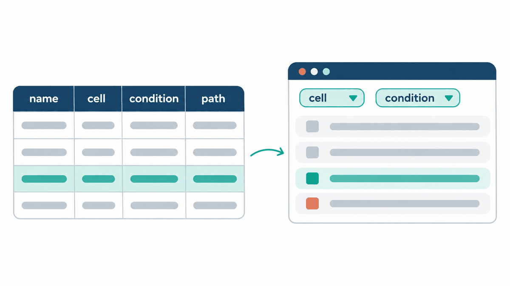

<p align="center">
  <picture>
    <source media="(prefers-color-scheme: dark)" srcset="docs/images/logo/hicarta-logo-wordmark-dark.png">
    
  </picture>
</p>

<h3 align="center">Explore Hi-C maps as easily as online maps</h3>

<p align="center">
HiCarta is a free desktop application for interactive visualization of Hi-C data. Pan and zoom with simple drag and scroll gestures, from multiple chromosomes down to individual genes.
View loops, ChIP-seq signals, and other genomic tracks alongside Hi-C maps, compare maps across experimental conditions, create custom tracks in R, and export editable figures for publication.
HiCarta runs on your own computer without requiring a separate server. Once R is installed, you can launch HiCarta with a double-click.
</p>

<p align="center">
  <a href="https://rafysta.github.io/HiCarta/"><b>📖 Documentation</b></a> ·
  <a href="https://youtu.be/C0b3ExIoMVM"><b>▶ 4-min demo</b></a> ·
  <a href="https://youtu.be/emcjmTKh6gQ"><b>▶ 1-min overview</b></a> ·
  <a href="#try-it-in-5-minutes"><b>⬇ Try it</b></a> ·
  <a href="README_ja.md">日本語</a>
</p>

https://github.com/user-attachments/assets/47df57ce-7c26-4497-b3c2-2df7bcc8d8ce

## Examples

| | | |
|:---:|:---:|:---:|
| <br>**Hi-C map** | <br>**Two conditions in a single map (upper and lower triangles)** | <br>**Rotated map + loops + ChIP-seq** |
| <br>**ChIP-seq tracks + genes** | <br>**Custom track written in R** | <br>**Multiple chromosomes in a single view** |

All figures shown above were exported from HiCarta as PDFs.

---

## Features

### 🗺 Navigate Hi-C maps intuitively
Drag to pan and scroll to zoom in and out. The map resolution adjusts automatically as you zoom, allowing you to navigate seamlessly from an entire chromosome down to regions spanning just a few kilobases. Use bookmarks to return to saved genomic regions with a single click.

### ⚖ Compare Hi-C maps from different conditions
Open a second sample to compare Hi-C maps from different conditions in a single view. Three comparison modes are available: **split** (display one map above the diagonal and the other below it), **curtain** (drag the boundary to reveal either map), and **difference** (display the ratio or difference between the two maps). HiCarta automatically adjusts for differences in sequencing depth between samples.

https://github.com/user-attachments/assets/87f08e95-5248-490c-91ee-6eff22e37a78

### 📚 Integrate Hi-C maps with other genomic data
Display the Hi-C map as a triangular track rotated by 45° and align it with chromatin loops (arcs), ChIP-seq and other signal tracks (bigWig), genomic intervals (BED), gene annotations (GFF3), and domain boundary strength (Border Strength). Tracks remain synchronized with the Hi-C map as you navigate, keeping the displayed data aligned to the same genomic region. These tracks can also be displayed beneath the conventional square Hi-C map.

https://github.com/user-attachments/assets/3e54be2d-4703-459c-b483-4d1128d5bb6c

### 📋 Manage your samples with a single Excel file
No database is required. Create a data catalog in Excel with one row per data file. Add your own metadata columns, such as cell type, experimental condition, or antibody. HiCarta automatically uses these columns as filters, allowing you to find the data you need among hundreds of samples in just a few clicks. Share the Excel file with collaborators so that everyone can work from the same catalog. Catalogs can be loaded from your local computer or the web.



### 🔒 Share unpublished data securely
HiCarta can access both local and cloud-hosted data and supports secure sharing of unpublished data with collaborators through Amazon S3 access controls.
Assign access-control tags to files stored in Amazon S3 and configure permissions based on those tags, so that only authorized users can access the files. Once the appropriate permissions have been configured, you can expand access—for example, upon publication—by changing the tags alone. There is no need to move the files or update their paths in the Excel catalog.


### 🧩 Create custom tracks in R
Extend HiCarta beyond its built-in visualization features by creating your own tracks in R.
To create a plugin, write a single R script containing two functions, `read()` and `draw()`. Place the script in the `plugins/` folder to make it available as a new track type. HiCarta automatically generates a settings dialog for the plugin. A virtual 4C plugin is included as an example.

https://github.com/user-attachments/assets/6d7d85dc-6bde-43dd-812e-6701cef4681b

### 🖨 Export editable, publication-ready figures
Use the print preview to see how your figure will look as you customize its contents. In exported PDFs, the Hi-C map is stored as a raster image, while the axes, labels, and tracks are preserved as editable vector graphics. This approach keeps file sizes manageable while allowing you to refine high-quality figures for publication in Adobe Illustrator, Inkscape, or similar tools.

### 🌐 Work with your existing data files
Open `.hic` files and track data directly from your local computer, web servers, Dropbox shared links, or Amazon S3 (public or private). For remote files, HiCarta retrieves only the required portions of the data, so you do not need to download entire files in advance.


---

## How HiCarta keeps navigation responsive

Like online mapping applications, HiCarta uses tile-based rendering. It divides the visible area into small rectangular tiles and prioritizes those at the center of the screen. For each tile, HiCarta retrieves only the required portions of the `.hic` or bigWig file, allowing you to browse large files hosted on web servers or in the cloud without downloading them in full. Connections are reused, and previously retrieved data are cached in memory for faster access when revisiting genomic regions. For slower network connections, an alternative mode downloads files to your local computer before rendering.

Data retrieval and rendering are handled by R on your own computer. The web browser serves as the user interface, eliminating the need to set up a separate server.

---

## Try it in 5 minutes

1. **Install R** (version 4.1 or later): <https://cran.r-project.org>
2. **Download HiCarta**: [ZIP](https://github.com/rafysta/HiCarta/archive/refs/heads/main.zip) (or `git clone https://github.com/rafysta/HiCarta.git`)
3. **Launch HiCarta**:
   - **Windows** — double-click `run_windows.bat`
   - **macOS** — double-click `run_mac.command` (if it is blocked, right-click → Open)

   On the first launch, HiCarta automatically installs the required R packages. This may take several minutes. Once setup is complete, HiCarta opens in your web browser.
4. **Explore the demo data**: open **Data**, paste the URL below into the catalog field, and click **Load**.

   ```
   https://uo-cgf.s3.us-west-2.amazonaws.com/HiCarta/demo/HiCarta_demo_catalog.xlsx
   ```

   Click a sample in the list to view the data. The demo uses public data from human IMR90 cells and fission yeast (see [Demo data](#demo-data)).

To use your own data, copy [`sample/HiCarta_catalog_template.xlsx`](sample/) and add one row per data file. See [Installation](https://rafysta.github.io/HiCarta/install/) and [Data catalog](https://rafysta.github.io/HiCarta/data-catalog/) for details.

---

## Comparison with other tools

Each tool has its own strengths. HiCarta is designed to help you explore, compare, and manage your research data on your own computer and turn your visualizations into editable figures for publication.

| | HiCarta | Juicebox | HiGlass | JBrowse 2 |
|---|:---:|:---:|:---:|:---:|
| No separate server required | ✓ | ✓ | – (needs a server) | ✓ (Desktop) |
| Hi-C, tracks and loops in one view | ✓ | ✓ | ✓ | ✓ |
| Compare two Hi-C maps | ✓ | ✓ | ✓ | ✓ |
| Create custom tracks in R | ✓ | – | – (JavaScript) | – (JavaScript) |
| Manage samples in Excel | ✓ | – | – | – |
| Share unpublished data | ✓ | – | △ (depends on the server setup) | △ |

Comparison based on the documentation for each tool as of November 2026.

---

## Supported data formats

| Data | Format | Notes |
|---|---|---|
| Contact maps | `.hic` (Juicer) | multiple resolutions; KR / ICE / raw; local and remote |
| Signal | bigWig | local and remote |
| Genomic intervals | BED | |
| Gene annotations | GFF3 | |
| Loops / interactions | BEDPE, HiCCUPS loop lists, ChIA-PET / HiChIP tables | drawn as arcs |
| Domain boundary strength | Border Strength (`*_BS.txt`) | |
| Custom tracks | user-defined R plugins | see [Plugins](https://rafysta.github.io/HiCarta/plugins/) |

**Planned:** support for `ggplot2` in plugins.

---

## Documentation and videos

- 📖 **Documentation: <https://rafysta.github.io/HiCarta/>**
  - [Installation](https://rafysta.github.io/HiCarta/install/) · [Usage](https://rafysta.github.io/HiCarta/usage/) · [Features](https://rafysta.github.io/HiCarta/features/)
  - [Data catalog (Excel)](https://rafysta.github.io/HiCarta/data-catalog/) · [Data formats](https://rafysta.github.io/HiCarta/data-formats/) · [Plugins](https://rafysta.github.io/HiCarta/plugins/)
  - [Setup details and troubleshooting](https://rafysta.github.io/HiCarta/setup-details/)
- ▶ Videos: [4-min demo](https://youtu.be/C0b3ExIoMVM) · [1-min overview](https://youtu.be/emcjmTKh6gQ)

### Configuration

HiCarta reads its startup settings from `config.txt` (create this file by copying `config.example.txt`). You can configure the default data catalog, the interface language (`en` / `ja`), the method for reading remote files, and other options. You can also edit these settings within HiCarta under **Setting → Edit config file…**. See [Setup details](https://rafysta.github.io/HiCarta/setup-details/) for more information.

---

## Demo data

All data in the demo catalog are public:

- IMR90 Hi-C (proliferating and oncogene-induced senescent cells) and CTCF / SMC1 / Pol II ChIP-seq — Iwasaki *et al.*, *Nat Commun* 2019 ([GEO GSE118494](https://www.ncbi.nlm.nih.gov/geo/query/acc.cgi?acc=GSE118494)). The Hi-C maps were generated exclusively from samples deposited in GEO.
- High-depth Hi-C data and loops (HiCCUPS) from IMR90 cells — Rao *et al.*, *Cell* 2014 ([GEO GSE63525](https://www.ncbi.nlm.nih.gov/geo/query/acc.cgi?acc=GSE63525)).
- Hi-C data from fission yeast in G2 phase and mitosis — Tanizawa *et al.*, *Nat Struct Mol Biol* 2017 ([GEO GSE93198](https://www.ncbi.nlm.nih.gov/geo/query/acc.cgi?acc=GSE93198)).
- Gene annotations — GENCODE v19 (human), PomBase (fission yeast).

---

## Feedback, citation, and license

- **Questions, bug reports, and feature requests:** please use [GitHub Issues](https://github.com/rafysta/HiCarta/issues). If you find HiCarta useful for your research, please consider giving the repository a ⭐ on GitHub to help other researchers discover it.
- **Citation:** until the HiCarta paper is published, please cite this repository as follows: Tanizawa H. *HiCarta: an interactive Hi-C viewer.* https://github.com/rafysta/HiCarta (2026).
- **Developer:** Hideki Tanizawa (<rafysta@gmail.com>), Institute for Genetic Medicine, Hokkaido University.
- **License:** [MIT](LICENSE).
