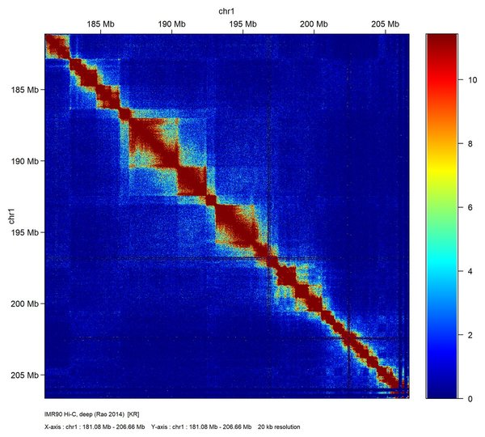
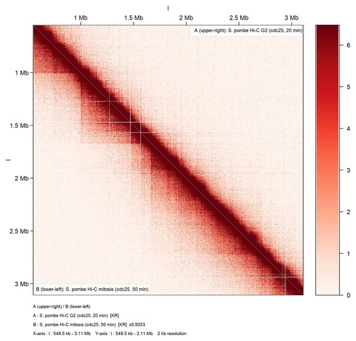
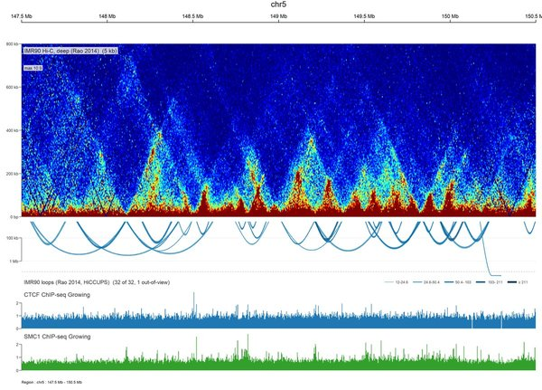
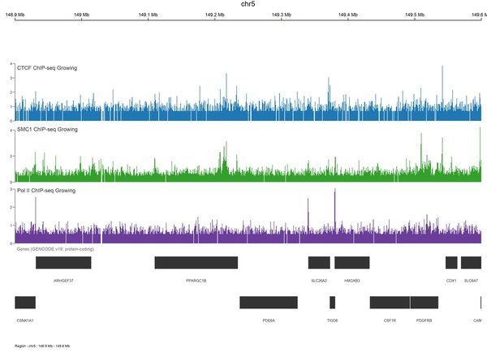
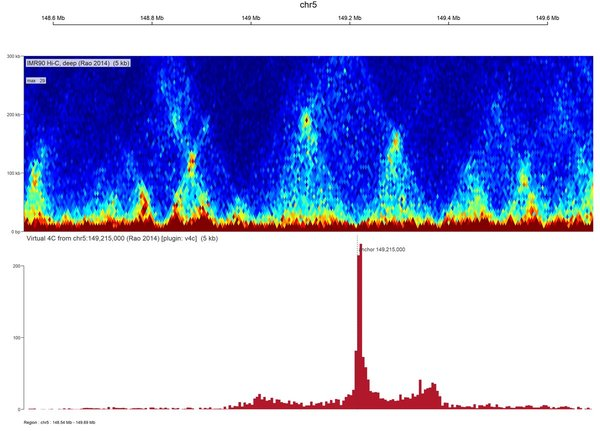
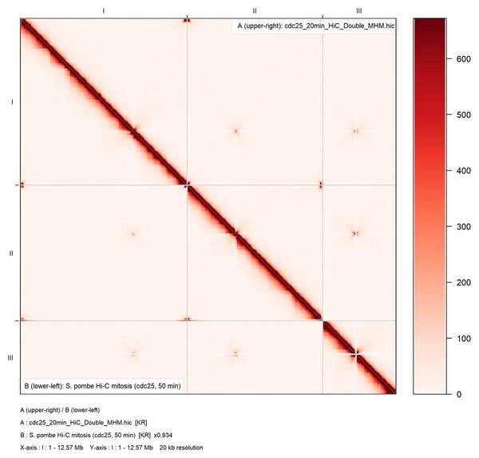
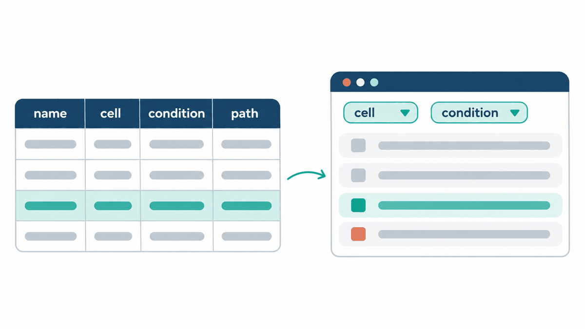
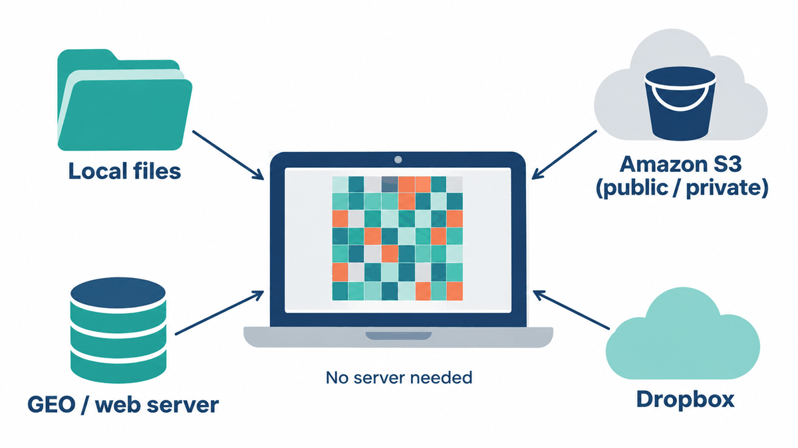
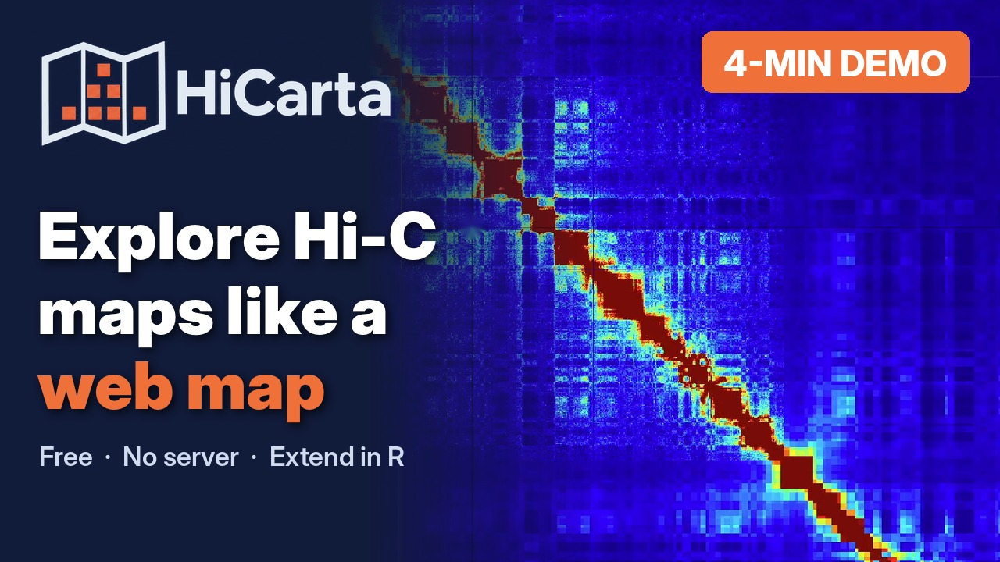
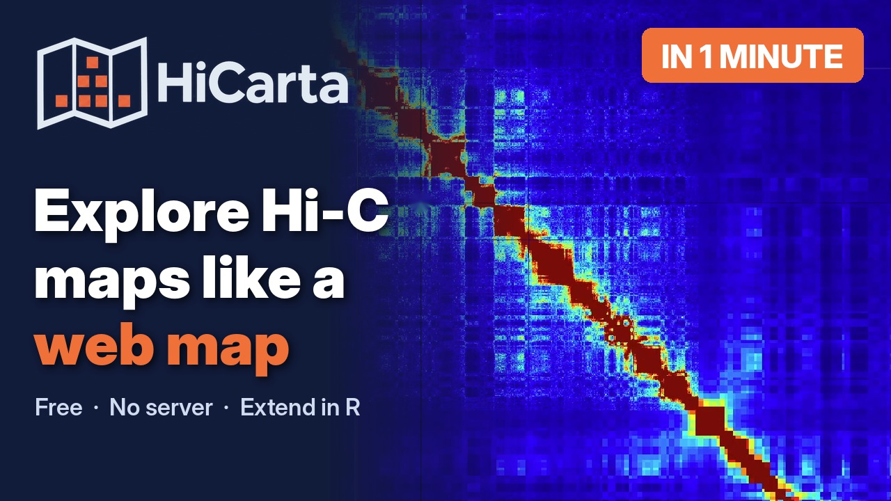

<p align="center">
  <picture>
    <source media="(prefers-color-scheme: dark)" srcset="docs/images/logo/hicarta-logo-wordmark-dark.png">
    
  </picture>
</p>

<h3 align="center">Hi-C マップを、地図アプリのように</h3>

<p align="center">
HiCarta は、Hi-C データを可視化する無料のデスクトップアプリです。複数の染色体を俯瞰するスケールから個々の遺伝子のスケールまで、ドラッグとスクロールで自由に移動・拡大・縮小できます。
ループや ChIP-seq などのトラックの同時表示、異なる条件の Hi-C マップの比較、R による独自の描画機能の追加、論文用の編集可能な図の出力にも対応しています。
お使いの PC 上で動作し、専用サーバーの構築は不要です。R をインストールしておけば、ダブルクリックで起動できます。
</p>

<p align="center">
  <a href="https://rafysta.github.io/HiCarta/ja/"><b>📖 ドキュメント</b></a> ·
  <a href="https://youtu.be/C0b3ExIoMVM"><b>▶ 4 分のデモ</b></a> ·
  <a href="https://youtu.be/emcjmTKh6gQ"><b>▶ 1 分の紹介</b></a> ·
  <a href="#5-分で試す"><b>⬇ 試す</b></a> ·
  <a href="README.md">English</a>
</p>

https://github.com/user-attachments/assets/47df57ce-7c26-4497-b3c2-2df7bcc8d8ce

## 可視化の例

|                                                                                                   |                                                                                                           |                                                                                                    |
| :-----------------------------------------------------------------------------------------------: | :-------------------------------------------------------------------------------------------------------: | :------------------------------------------------------------------------------------------------: |
| <br>**Hi-C マップ** | <br>**2 条件の Hi-C マップの比較（右上と左下に分割表示）** | <br>**回転マップ＋ループ＋ChIP-seq** |
| <br>**ChIP-seq トラック＋遺伝子** | <br>**R によるカスタムトラック** | <br>**複数の染色体を同時表示** |

上の図はすべて HiCarta から PDF として出力したものです。

---

## 特徴

### 🗺 地図アプリのように直感的に操作する
ドラッグで表示領域を移動し、スクロールで拡大・縮小できます。解像度は拡大率に応じて自動的に切り替わり、染色体全体から数 kb の領域までシームレスに閲覧できます。ブックマークを使えば、登録したゲノム領域に 1 クリックで戻れます。

### ⚖ 異なる条件の Hi-C マップを比較する
2 つ目のサンプルを開くと、異なる条件の Hi-C マップを同一画面上で比較できます。比較方法は、**split**（対角線を境に右上と左下に分割表示）、**curtain**（境界をドラッグして表示範囲を切り替え）、**difference**（2 つのマップの比または差を可視化）の 3 種類です。サンプル間のリード数の違いは自動的に補正されます。

https://github.com/user-attachments/assets/87f08e95-5248-490c-91ee-6eff22e37a78

### 📚 Hi-C マップとさまざまなゲノムデータを同時に表示する
Hi-C マップを 45 度回転させた三角形のトラックとして表示し、ループ（弧）、ChIP-seq などのシグナル（bigWig）、ゲノム区間（BED）、遺伝子（GFF3）、ドメイン境界強度（Border Strength）と並べて表示できます。各トラックの表示位置は Hi-C マップと連動するため、同じゲノム領域の情報を比較できます。通常の正方形の Hi-C マップでも、これらのデータを組み合わせて表示できます。

https://github.com/user-attachments/assets/3e54be2d-4703-459c-b483-4d1128d5bb6c

### 📋 Excel ファイル 1 つでサンプルを管理する
専用のデータベースを構築する必要はありません。Excel に 1 行につき 1 ファイルの情報を記載するだけで、データカタログを作成できます。細胞種、実験条件、抗体などの項目は、列として自由に追加できます。追加した項目は HiCarta の絞り込み機能に反映されるため、数百のサンプルから目的のデータを数クリックで探し出せます。同じ Excel ファイルを共同研究者と共有すれば、共通のデータカタログを利用できます。Excel ファイルはローカル環境からもオンラインからも読み込めます。



### 🔒 未発表データを安全に共有する
HiCarta は、ローカル環境やクラウド環境からのデータの読み込みに対応しており、Amazon S3 のアクセス制御を利用して未発表データを共同研究者と共有できます。
Amazon S3 に保存したファイルにアクセス制御用のタグを付け、タグに応じたアクセス権限を設定することで、許可されたユーザーだけがファイルを閲覧できるようにします。あらかじめアクセス権限を設定しておけば、論文の公開時などに共有範囲を広げたい場合も、タグを変更するだけで対応できます。ファイルを移動する必要はなく、Excel に記載したファイルのパスもそのまま利用できます。


### 🧩 R で独自の描画機能を追加する
HiCarta が標準で提供する描画機能に加え、R で独自のトラックを作成できます。
プラグインの作成に必要なのは、`read()` と `draw()` の 2 つの関数を記述した R スクリプトファイル 1 つだけです。このファイルを `plugins/` フォルダに置くと、新しい種類のトラックとして利用でき、プラグイン用の設定画面も自動的に生成されます。実装例として、virtual 4C のプラグインを同梱しています。

https://github.com/user-attachments/assets/6d7d85dc-6bde-43dd-812e-6701cef4681b

### 🖨 論文用の編集可能な図を出力する
印刷プレビューで出力イメージを確認しながら、図に含める要素を細かく調整できます。PDF 出力では、Hi-C マップをラスター画像として、軸・ラベル・トラックなどを編集可能なベクター形式で保存します。これにより、ファイルサイズを抑えながら、Illustrator や Inkscape などで編集可能な、論文用の高品質な図を作成できます。

### 🌐 既存のデータファイルをそのまま利用する
`.hic` ファイルや各種トラックのデータを、ローカルの PC、Web サーバー、Dropbox の共有リンク、Amazon S3（公開・非公開）から開けます。リモートファイルは必要な部分だけを読み込むため、事前にファイル全体をダウンロードする必要はありません。



---

## 高速で快適な操作を支える仕組み

HiCarta は、Web 地図アプリと同様にタイルベースの描画方式を採用しています。表示領域を小さな矩形のタイルに分割し、画面中央のタイルを優先して描画します。タイルごとに `.hic` ファイルや bigWig ファイルから必要な部分だけを読み込むため、Web サーバーやクラウド上の大容量ファイルも、全体をダウンロードせずに閲覧できます。また、接続を再利用し、読み込み済みのデータをメモリにキャッシュすることで、一度閲覧した領域に戻る際にも高速に表示できます。通信速度が遅い環境向けに、ファイルをローカルに保存してから描画するモードも用意しています。

データの読み込みと描画処理は、お使いの PC 上で R が行います。Web ブラウザはユーザーインターフェースとして使用するため、専用のサーバーを別途用意する必要はありません。

---

## 5 分で試す

1. **R をインストール**（バージョン 4.1 以上）: <https://cran.r-project.org>
2. **HiCarta をダウンロード**: [ZIP](https://github.com/rafysta/HiCarta/archive/refs/heads/main.zip)（または `git clone https://github.com/rafysta/HiCarta.git`）
3. **起動**:
   - **Windows** — `run_windows.bat` をダブルクリック
   - **macOS** — `run_mac.command` をダブルクリック（起動がブロックされた場合は右クリック → 開く）

   初回起動時は必要な R パッケージが自動的にインストールされるため、数分かかることがあります。インストールが完了すると、Web ブラウザで HiCarta が起動します。
4. **デモデータを開く**: **Data** を開き、カタログの入力欄に以下の URL を貼り付けて **Load** をクリックします。

   ```
   https://uo-cgf.s3.us-west-2.amazonaws.com/HiCarta/demo/HiCarta_demo_catalog.xlsx
   ```

   一覧からサンプルをクリックすると、データを閲覧できます。デモでは、ヒト IMR90 細胞と分裂酵母の公開データを使用しています（詳細は [デモデータ](#デモデータ) を参照）。

ご自身のデータを利用する場合は、[`sample/HiCarta_catalog_template.xlsx`](sample/) をコピーし、1 行につき 1 ファイルの情報を記載してください。詳細は [インストール](https://rafysta.github.io/HiCarta/ja/install/) と [データカタログ](https://rafysta.github.io/HiCarta/ja/data-catalog/) を参照してください。

---

## 他のツールとの比較

各ツールにはそれぞれ異なる特徴があります。HiCarta は、研究室で保有するデータを手元の PC で手軽に閲覧・比較し、その結果を論文用の図として出力することを重視しています。

|                    | HiCarta | Juicebox |    HiGlass    |   JBrowse 2   |
| ------------------ | :-----: | :------: | :-----------: | :-----------: |
| 専用サーバーの構築が不要       |    ✓    |    ✓     |  –（サーバーが必要）   | ✓（Desktop 版）  |
| Hi-C、トラック、ループの同時表示 |    ✓    |    ✓     |       ✓       |       ✓       |
| 2 つの Hi-C マップの比較   |    ✓    |    ✓     |       ✓       |       ✓       |
| R によるカスタム描画機能の追加   |    ✓    |    –     | –（JavaScript） | –（JavaScript） |
| Excel によるサンプル管理    |    ✓    |    –     |       –       |       –       |
| 非公開データの共有機能        |    ✓    |    –     | △（サーバーの設定による） |       △       |

2026 年 11 月時点の各ツールのドキュメントに基づく比較です。

---

## 対応データ形式

| データ | 形式 | 備考 |
|---|---|---|
| コンタクトマップ | `.hic`（Juicer） | 複数解像度、KR／ICE／raw、ローカル・リモート対応 |
| シグナル | bigWig | ローカル・リモート対応 |
| ゲノム区間 | BED | |
| 遺伝子 | GFF3 | |
| ループ・相互作用 | BEDPE、HiCCUPS のループ一覧、ChIA-PET／HiChIP の表 | 弧として描画 |
| ドメイン境界強度 | Border Strength（`*_BS.txt`） | |
| その他 | 自作プラグイン（R） | [プラグイン](https://rafysta.github.io/HiCarta/ja/plugins/) を参照 |

**対応予定:** `.cool`／`.mcool` ファイルの読み込み、プラグインでの `ggplot2` の利用。

---

## ドキュメントと動画

- 📖 **ドキュメント: <https://rafysta.github.io/HiCarta/ja/>**
  - [インストール](https://rafysta.github.io/HiCarta/ja/install/) · [使い方](https://rafysta.github.io/HiCarta/ja/usage/) · [機能](https://rafysta.github.io/HiCarta/ja/features/)
  - [データカタログ（Excel）](https://rafysta.github.io/HiCarta/ja/data-catalog/) · [データ形式](https://rafysta.github.io/HiCarta/ja/data-formats/) · [プラグイン](https://rafysta.github.io/HiCarta/ja/plugins/)
  - [セットアップの詳細とトラブルシューティング](https://rafysta.github.io/HiCarta/ja/setup-details/)
- ▶ YouTube の動画（サムネイルをクリックすると再生できます）:

| | |
|:---:|:---:|
| <a href="https://youtu.be/C0b3ExIoMVM"></a><br>**▶ 4 分のデモ** | <a href="https://youtu.be/emcjmTKh6gQ"></a><br>**▶ 1 分の紹介** |

### 設定

起動時の設定は `config.txt` から読み込まれます（`config.example.txt` をコピーして作成してください）。既定のデータカタログ、表示言語（`en`／`ja`）、リモートファイルの読み込み方法などを設定できます。アプリの **Setting → Edit config file…** からも編集できます。詳細は [セットアップの詳細](https://rafysta.github.io/HiCarta/ja/setup-details/) を参照してください。

---

## デモデータ

デモカタログのデータはすべて公開データです。

- IMR90 細胞の Hi-C（増殖細胞およびがん遺伝子誘導性老化細胞）と CTCF／SMC1／Pol II の ChIP-seq — Iwasaki *et al.*, *Nat Commun* 2019（[GEO GSE118494](https://www.ncbi.nlm.nih.gov/geo/query/acc.cgi?acc=GSE118494)）。Hi-C マップは GEO に登録されたサンプルのみを用いて作成しています。
- IMR90 細胞の高深度 Hi-C データとループ（HiCCUPS）— Rao *et al.*, *Cell* 2014（[GEO GSE63525](https://www.ncbi.nlm.nih.gov/geo/query/acc.cgi?acc=GSE63525)）。
- 分裂酵母の G2 期および分裂期の Hi-C — Tanizawa *et al.*, *Nat Struct Mol Biol* 2017（[GEO GSE93198](https://www.ncbi.nlm.nih.gov/geo/query/acc.cgi?acc=GSE93198)）。
- 遺伝子アノテーション — GENCODE v19（ヒト）、PomBase（分裂酵母）。

---

## 要望・引用・ライセンス

- **質問・不具合報告・機能のご要望:** [GitHub Issues](https://github.com/rafysta/HiCarta/issues) からお知らせください。HiCarta が研究のお役に立ちましたら、GitHub で ⭐（Star）を付けていただけると、より多くの研究者に知っていただくきっかけになります。
- **引用:** HiCarta の論文が公開されるまでは、以下の形式で本リポジトリを引用してください: Tanizawa H. *HiCarta: an interactive Hi-C viewer.* https://github.com/rafysta/HiCarta (2026).
- **開発者:** 谷澤英樹（<rafysta@gmail.com>）、北海道大学 遺伝子病制御研究所
- **ライセンス:** [MIT](LICENSE)
