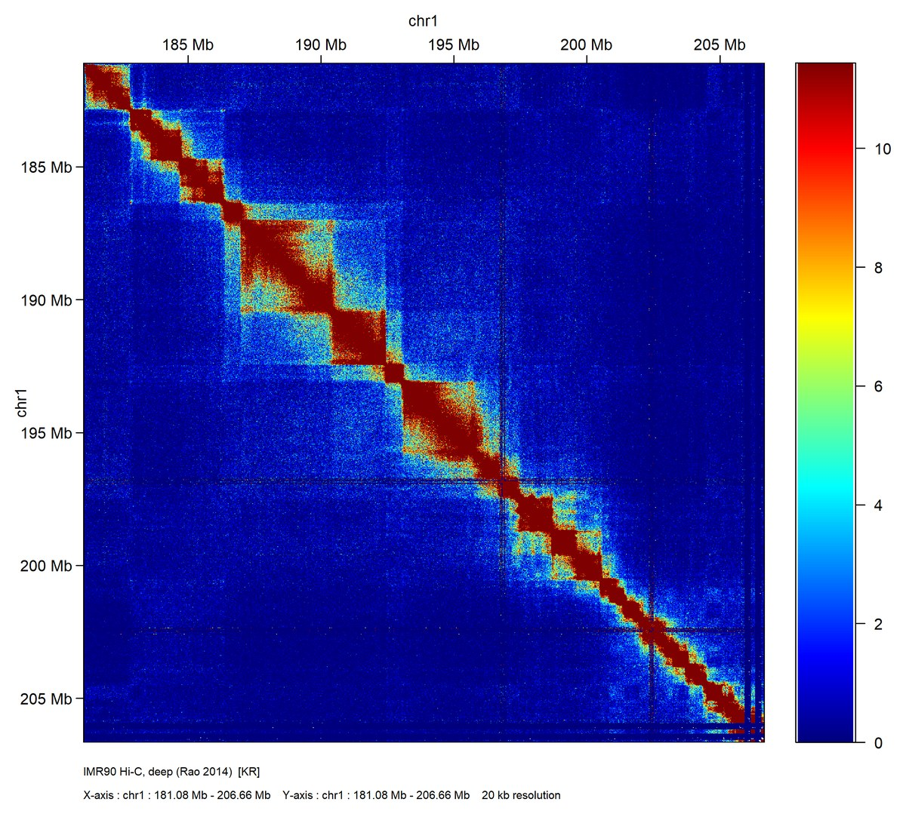
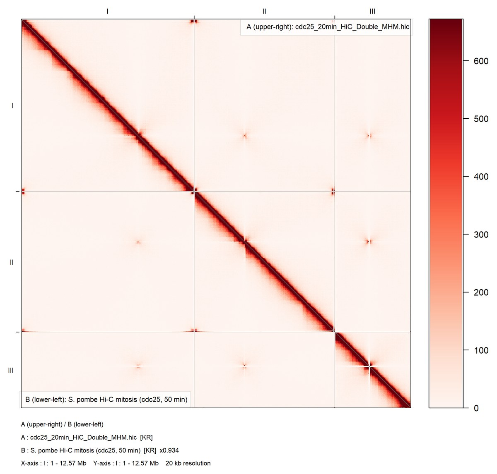
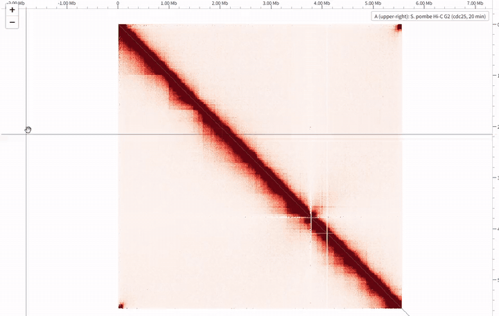
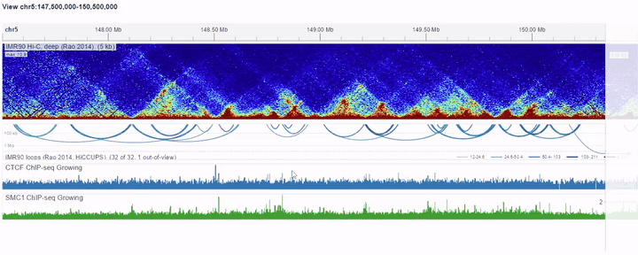
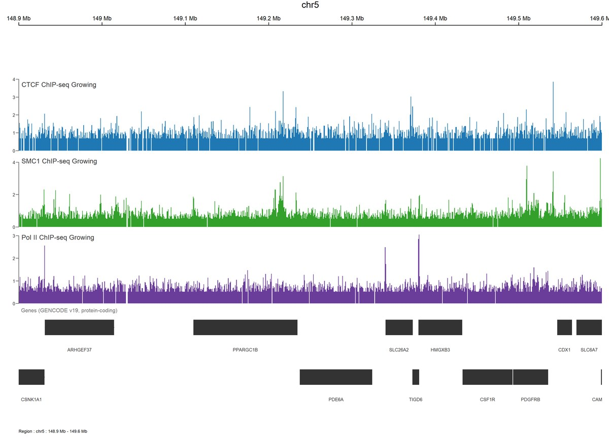
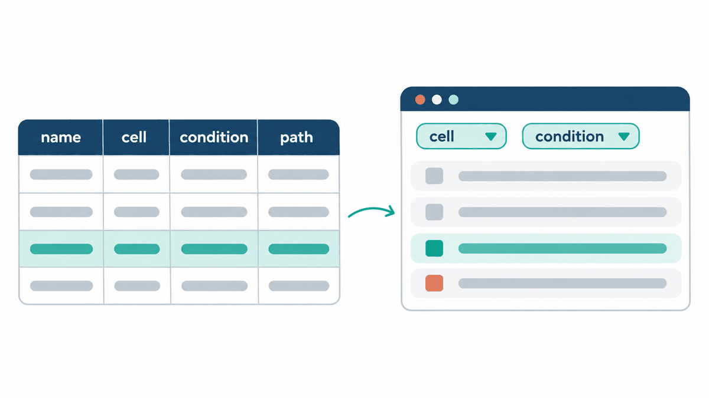
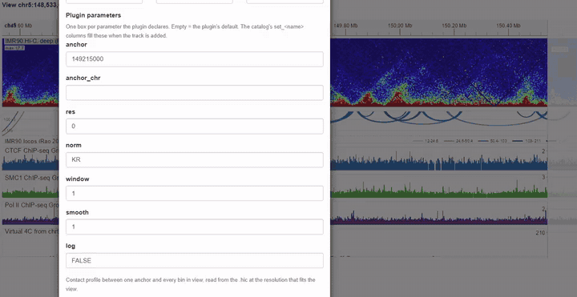
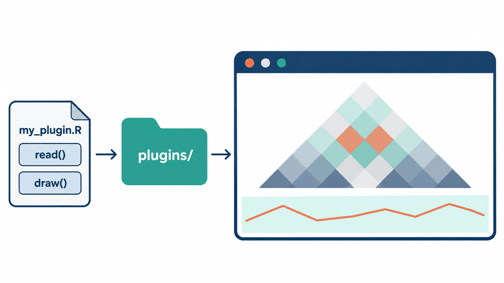
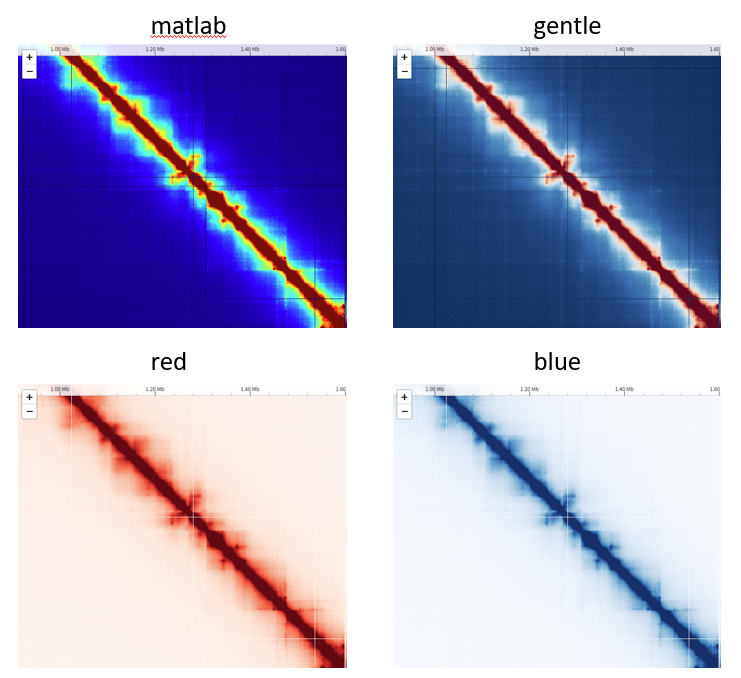

# What HiCarta can do

Explore HiCarta’s features through screenshots and short videos. Each feature links to the relevant sections of **[Usage](usage.md)** and **[Screens & controls](interface.md)** for detailed instructions. All examples on this page use publicly available **[demo data](demo-data.md)** visualized in HiCarta.

---

## Navigate Hi-C maps intuitively

Drag to pan and scroll to zoom in and out. The resolution adjusts automatically to the zoom level, allowing seamless navigation from an entire chromosome down to a few kilobases. HiCarta retrieves only the data needed to render the current view, helping maintain responsive navigation even with high-resolution maps and large genomes.

- **Go anywhere** — enter a chromosome and a range to move to the region you want. → [Move to any location](usage.md#goto)
- **Move with buttons** — pan the map in fixed increments using the eight directional buttons. → [Move with buttons](usage.md#pan)
- **Bookmarks** — save a named region of interest and return to it with one click. A bookmark records only the genomic position, so after switching samples the same bookmark shows the same region in the new sample. Bookmarks can also be exchanged as Excel files. → [Bookmark a region of interest](usage.md#bookmark)

### Explore whole-genome and inter-chromosomal contacts

{ width="500" }

Display all chromosomes along both axes to visualize every chromosome pair at once, then zoom into any block. You can also choose a different chromosome for the vertical axis to show only the contacts between two chromosomes (trans). → [Navigate](interface.md#navigate)

---

## Compare Hi-C maps from different conditions

Open a second sample to compare Hi-C maps from different conditions on one screen. There are three ways to compare:

| View | What it does |
|---|---|
| **Split** | Shows sample A above and sample B below the diagonal (upper right and lower left). |
| **Curtain** | Drag the divider to switch between the samples on its two sides. The spacebar switches the whole map between A and B instantly. |
| **Difference** | Shows the log2 ratio or the difference of the two maps on a symmetric scale centered on 0. Palettes designed for users with color vision deficiencies are available. |

When automatic sequencing-depth correction is enabled, HiCarta scales sample B using the ratio of total contact counts (A / B). → **[Tutorial: compare two conditions](tutorial-compare.md)**

---

## View Hi-C maps alongside other genomic data

The following tracks can be shown below the Hi-C map. Tracks remain synchronized with the Hi-C map as you navigate, keeping the displayed data aligned to the same genomic region.

| Track | What it shows |
|---|---|
| **Rotated map (RotMap)** | The Hi-C map as a triangular track rotated by 45 degrees. Configure the distance range, orientation, colors, normalization, and observed/expected (O/E) display. |
| **Loops (arcs)** | BEDPE files, HiCCUPS loop lists and ChIA-PET / HiChIP tables, drawn as arcs. Color and line width can reflect interaction strength. |
| **Signal** | bigWig (e.g., ChIP-seq signals). The drawing resolution can be set for each track. |
| **Genomic intervals and genes** | BED, GFF3 |
| **Domain boundary strength** | Border Strength (`*_BS.txt`) |

- **Tracks only** — hide the square contact map and display only the rotated map and other tracks. You can also show tracks without opening a Hi-C map at all. → [Tracks without a contact map](usage.md#tracks-only)
- **Appearance** — set the name, color, height and maximum / minimum of each track. Drag the chips to change the order. → [Tracks](interface.md#tracks)

---

## Manage your samples with a single Excel file

{ width="600" }

No database is required. Create an Excel data catalog with one row per sample. Add metadata columns, such as cell type, experimental condition, or antibody. Columns with 20 or fewer distinct values become filters, helping you find the desired data among hundreds of samples. Share the same Excel file with collaborators to work from a common catalog. → **[Data catalog](data-catalog.md)**

---

## Share unpublished data securely

{ width="600" }

Assign access-control tags to files stored in Amazon S3 and configure permissions based on those tags so that only authorized users can open the files. Once the permissions are configured, you can expand access (e.g., upon publication) by changing the relevant tag. There is no need to move the files or change the paths in your Excel catalog. → [Private data on Amazon S3](data-catalog.md#private-data-on-amazon-s3)

---

## Create custom tracks in R (plugins)

Extend HiCarta’s built-in visualization features by creating custom tracks in R. A typical plugin is a single R script defining `read()` and `draw()` functions. Place it in the `plugins/` folder to make it available as a new track type. HiCarta automatically generates a settings dialog for the plugin. Plugins also work with the catalog, with saving and restoring sessions, and with figure export. Two plugins are included: one draws a table with the columns `chr`, `start`, `end` and `value`, and one draws a Virtual 4C profile read from a `.hic` file. → **[Plugins](plugins.md)**

{ width="600" }

---

## Export editable, publication-ready figures

Use the print preview to review the figure while adjusting its contents, including coordinate ticks, the legend, tracks, and sample information. In the PDF, the Hi-C map is saved as a raster image and the axes, labels and tracks as editable vector graphics. This helps keep file sizes manageable while allowing further editing in Illustrator, Inkscape, or similar tools. PNG output and printing directly to a printer are also available. → **[Tutorial: make a publication figure](tutorial-figure.md)**

---

## Work with your existing data files

{ width="600" }

Open `.hic` files and track data from your own computer, a web server, Dropbox shared links or Amazon S3 (public or private).

- **On-demand data retrieval** — by default, HiCarta retrieves only the portions of remote `.hic` and bigWig files required for the current view with HTTP range requests. There is no need to download the whole file.
- **Caching for faster navigation** — previously retrieved data are cached in memory, speeding up revisits to cached regions.
- **On a slow connection** — a setting switches to a mode that saves the whole file locally before drawing (`hic_engine = download`).
- BED, GFF3 and Border Strength files are read in full when loaded.

→ **[How HiCarta works](how-it-works.md)**

---

## Other features

- **Color scale** — choose from four palettes (matlab, gentle, red, blue) and set the maximum with a linear or log10 slider. → [Change the contrast (color intensity)](usage.md#contrast)

    

- **Normalization and resolution** — switch the normalization (KR, ICE, Raw and so on) and the resolution of an open map without reopening it. → [Display](interface.md#display)
- **Sessions** — save the whole view, including data sources, the genomic region, the color scale, and all tracks, to one file (`.json`), and restore it later. → [Save the view and reproduce it later (session)](usage.md#session)
- **Open in IGV** — send a sample from the catalog to a running IGV. → [Open in IGV](data-catalog.md#open-in-igv)
- **Interface language** — switch the interface between English and Japanese. → [Switch the display language](usage.md#language)
