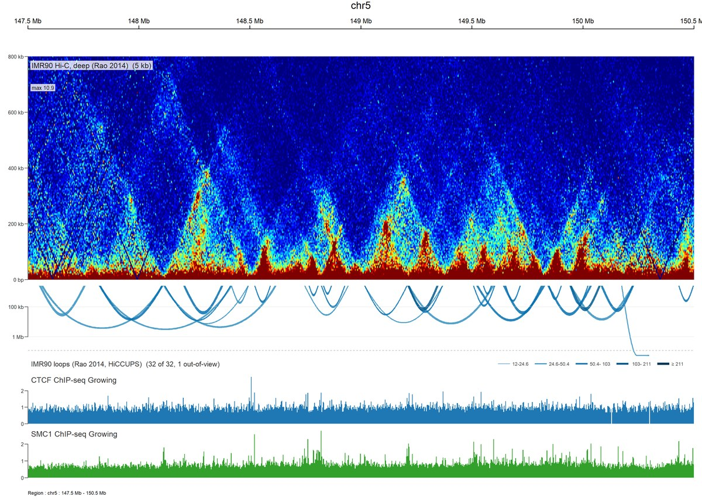

# First 5 minutes

Learn the basic operations of HiCarta using the **demo catalog**, a collection of publicly available datasets. There are six steps: **load the catalog → open a Hi-C map → move and zoom → add tracks → move with bookmarks → export a figure**.

All data are available online, so no manual downloads are required. By default, HiCarta retrieves only the portions of each `.hic` or bigWig file needed for the current view.

!!! note "Before you start"
    Install and start HiCarta (**[Installation](install.md)**). An internet connection is required.

## 1. Load the demo catalog {#load-catalog}

1. Click **Data** at the top of the screen.
2. On the **Data browser** tab, paste the following URL into the "Catalog (.xlsx) path or URL" field.

    ```
    https://uo-cgf.s3.us-west-2.amazonaws.com/HiCarta/demo/HiCarta_demo_catalog.xlsx
    ```

3. Click **Load catalog**.

The sample list appears. Use the filters on the left to narrow the list by columns such as organism (`organism`) and experiment type (`experiment_type`). See **[Demo data](demo-data.md)** for a list of available datasets.

## 2. Open a Hi-C map

1. Click the row **IMR90 Hi-C, deep (Rao 2014)** in the list.
2. In the details that appear, click **Open as contact map**.

The high-depth Hi-C map of human IMR90 cells (Rao *et al.*, 2014) opens.

## 3. Move and zoom

- **Drag** to pan and use the **mouse wheel** to zoom in and out. The resolution changes automatically with the zoom.
- To go straight to a region, choose `chr5` as the X-axis chromosome in the **Navigate** panel on the left, enter `147500000` as the start and `150500000` as the end, and click **Go to region**.
- If the map is too light or too dark, adjust **Max value** under **Display → Map**.

In this region, the map shows punctate contact enrichments corresponding to loops.

## 4. Add tracks

Return to the Data browser by clicking **Data**. Select each of the following rows in turn, then click **Add as track**. Before adding a track, you can adjust its label, color, and height.

| Row | What it shows |
|---|---|
| **IMR90 loops (Rao 2014, HiCCUPS)** | Loops drawn as arcs |
| **CTCF ChIP-seq Growing** | CTCF ChIP-seq signal |
| **SMC1 ChIP-seq Growing** | ChIP-seq signal of SMC1, a subunit of cohesin |
| **Genes (GENCODE v19, protein-coding)** | Genes |

In addition, click **Add as rotated map** in the row **IMR90 Hi-C, deep (Rao 2014)** to show the Hi-C map as a triangular track rotated by 45 degrees. All tracks remain aligned with the Hi-C map as you navigate.



!!! tip "Tips for improving visibility"
    - Click a track's name under **Display → Tracks** to change its settings. Setting the maximum to about 6 for CTCF and 8 for SMC1 makes the peaks easier to see.
    - In the loop track, set "Max distance (bp)" to `2000000` (2 Mb) to show the loops in this region.
    - To hide the square Hi-C map and show only the rotated map and the tracks, use **Hide contact map (tracks only)** under **Display → Map**.

You can now check how the loop anchors are positioned relative to the CTCF and SMC1 peaks.

## 5. Move with bookmarks

The file `sample/HiCarta_demo_bookmarks_hg19.xlsx` in the HiCarta folder you downloaded contains bookmarks for the demo regions and for senescence-associated secretory phenotype (SASP) genes.

1. Open the bookmark section of the **Navigate** panel, select this file with **Browse…** in the **Load from Excel (append)** field, and click **Load**.
2. Click **PDGFRB / CSF1R (chr5)** in the list to move to that region.

A bookmark records only the genomic location. After opening a different sample, you can use the same bookmark to navigate to that region.

## 6. Export a figure

1. Open **Print** at the top of the screen and click **Open print preview**.
2. Set the destination to **File** and the format to **PDF**, and choose the output folder and the file name.
3. Make sure **Also export tracks** is enabled, and click **Run**.

In the PDF, the Hi-C map is saved as a raster image and the axes, labels and tracks as editable vector graphics. See **[Make a publication figure](tutorial-figure.md)** for details.

---

## What to read next

- **[Compare two conditions](tutorial-compare.md)** — compare the Hi-C maps of fission yeast in G2 and in mitosis from the demo catalog.
- **[Data catalog](data-catalog.md)** — learn how to create a catalog for your own data. You can start from a copy of `sample/HiCarta_catalog_template.xlsx`.
- **[What HiCarta can do](features.md)** — the list of HiCarta's features.
