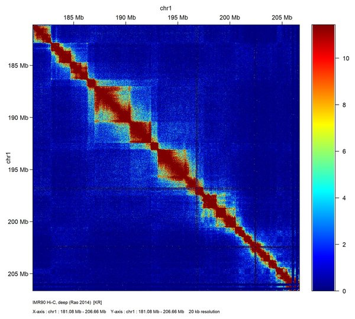
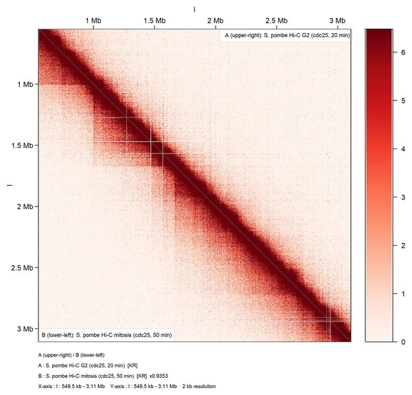
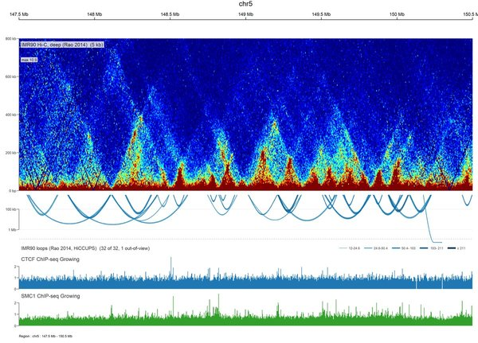
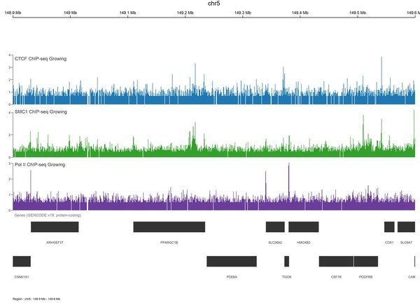
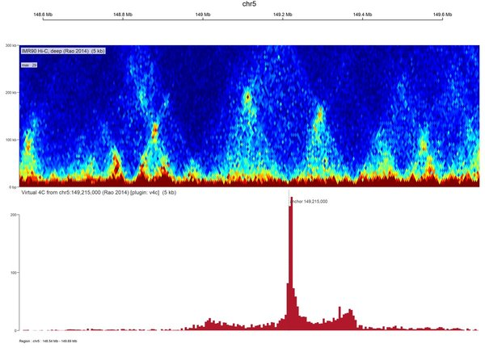
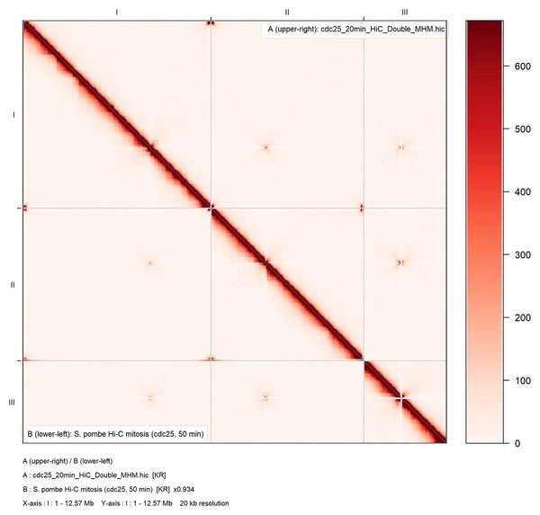

# HiCarta

**Explore Hi-C maps as easily as online maps.**

HiCarta is a free desktop application for interactive visualization of Hi-C data. Pan and zoom with simple drag and scroll gestures, from a whole-genome view down to individual genes. View loops, ChIP-seq signals, and other genomic tracks alongside Hi-C maps, compare maps across experimental conditions, create custom tracks in R, and export editable figures for publication.

HiCarta runs on your own computer without requiring a separate server. Once R is installed, you can launch HiCarta with a double-click. The name "Carta" alludes to maps and charts.

<iframe src="https://www.youtube-nocookie.com/embed/C0b3ExIoMVM" title="HiCarta demo (4 min)" style="position:absolute; top:0; left:0; width:100%; height:100%; border:0;" allow="accelerometer; encrypted-media; gyroscope; picture-in-picture" allowfullscreen></iframe>

Watch the 4-minute demo above or the [1-minute overview](https://youtu.be/emcjmTKh6gQ).

## Examples

| | | |
|:---:|:---:|:---:|
|  **Hi-C map** |  **Two conditions in a split view (upper right and lower left)** |  **Rotated map + loops + ChIP-seq** |
|  **ChIP-seq tracks + genes** |  **Custom track written in R** |  **Multiple chromosomes in a single view** |

All the figures above were exported from HiCarta as PDFs. Learn more in **[What HiCarta can do](features.md)**.

## Find what you need

- :material-rocket-launch: **[First 5 minutes](first-5-minutes.md)** — use public data to open a map, add tracks, and export a figure
- :material-download: **[Installation](install.md)** — install and start HiCarta on Windows or macOS
- :material-compare: **[Compare two conditions](tutorial-compare.md)** — three comparison modes: split, curtain, and difference
- :material-file-pdf-box: **[Make a publication figure](tutorial-figure.md)** — export a PDF from the print preview and finish it in Illustrator or similar tools
- :material-file-table: **[Use your own data](data-catalog.md)** — create an Excel data catalog
- :material-lock: **[Share unpublished data](data-catalog.md#private-data-on-amazon-s3)** — use Amazon S3 access controls
- :material-puzzle: **[Create your own track](plugins.md)** — extend HiCarta with R plugins
- :material-scale-balance: **[Comparison with other tools](comparison.md)** — how HiCarta differs from Juicebox, HiGlass, JBrowse 2 and others

## Work with your existing data files

{ width="600" }

Open `.hic` files and track data from your own computer, a web server, Dropbox shared links or Amazon S3 (public or private). HiCarta retrieves only the required portions of remote `.hic` and bigWig files by default, so you do not need to download entire files in advance. **[How HiCarta works](how-it-works.md)** explains how this works.

## Quick start

1. Install R (4.1 or later) from <https://cran.r-project.org>.
2. On [GitHub](https://github.com/rafysta/HiCarta), download the code using **Code → Download ZIP** and unzip it.

    { width="400" }

3. Start HiCarta.
    - **Windows** — double-click `run_windows.bat`.
    - **macOS** — double-click `run_mac.command` (if it is blocked, right-click → Open).

    On the first launch, the required R packages are installed automatically, which can take a few minutes.
4. HiCarta appears in your web browser. Next, open the demo data in **[First 5 minutes](first-5-minutes.md)**.

See **[Installation](install.md)** and **[Setup details & troubleshooting](setup-details.md)** for details.

---

Developer: **Hideki Tanizawa** (<rafysta@gmail.com>), Institute for Genetic Medicine, Hokkaido University
Source: [github.com/rafysta/HiCarta](https://github.com/rafysta/HiCarta) · MIT License
Please submit questions, bug reports, and feature requests through [GitHub Issues](https://github.com/rafysta/HiCarta/issues).
