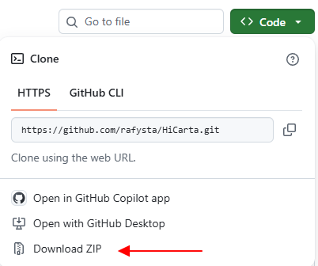

# Installation

HiCarta is a desktop application that runs locally on your computer. You do not need to set up a server or sign up for a HiCarta account.

On Windows, you can get started in three steps. For macOS, see the link at the end of this page.

## 1. Install R

Open <https://cran.r-project.org> and download and install R for Windows (4.1 or later). In most cases, you can accept the default installation options.

!!! note "RStudio is not required"
    You only need to install R itself; HiCarta installs its required R packages on first launch. Having RStudio installed is also fine.

## 2. Download and unzip HiCarta

Open the GitHub page <https://github.com/rafysta/HiCarta>, then click the green **"Code"** button → **"Download ZIP"**.

{ width="400" }

Right-click the downloaded ZIP file and choose "Extract All" to unzip it. You can extract it to any convenient location, such as your Desktop.

## 3. Double-click `run_windows.bat`

Inside the unzipped folder, double-click **`run_windows.bat`**.

On first launch, HiCarta automatically installs the required R packages, which may take a few minutes. Once setup is complete, HiCarta opens automatically in a browser tab (the address is `http://127.0.0.1:7788`).

Subsequent launches are usually faster. To quit the app, close the launcher window (Command Prompt).

---

You are now ready to use HiCarta. For basic operations, see **[Usage](usage.md)**; for a detailed reference to the interface, see **[Screens & controls](interface.md)**.

For macOS instructions, manual installation, or help with startup problems, see **[Setup details & troubleshooting](setup-details.md)**.
