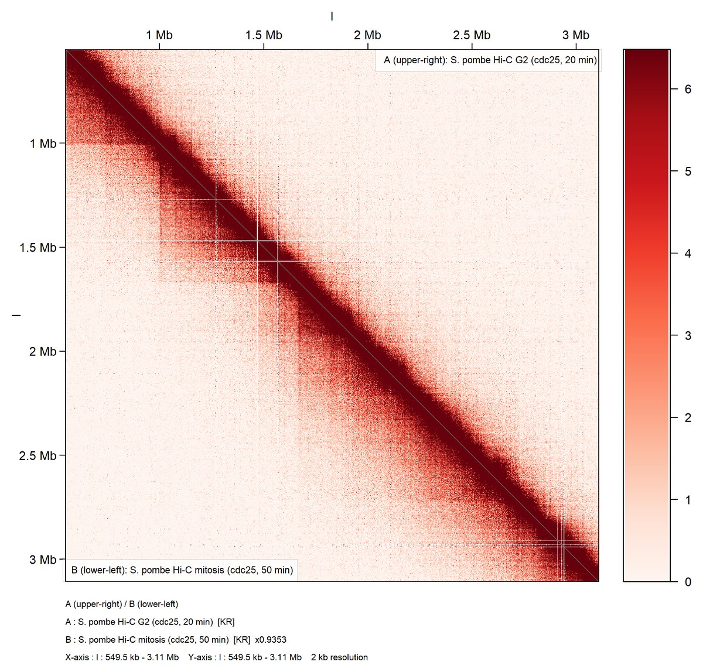
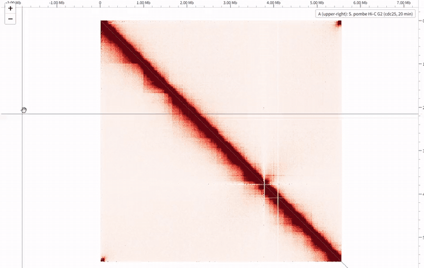

# Tutorial: compare two conditions

This tutorial explains how to compare two Hi-C maps in a single view, using fission yeast Hi-C data from G2 phase and mitosis in the **[demo data](demo-data.md)** (Tanizawa *et al.*, *Nat Struct Mol Biol* 2017). The data were collected from synchronized *cdc25-22* cells, 20 minutes (G2) and 50 minutes (mitosis) after release from the cell-cycle block.

## 1. Open sample A

1. Open **Data** and load the demo catalog (see **[First 5 minutes](first-5-minutes.md#load-catalog)**).
2. Click the row **S. pombe Hi-C G2 (cdc25, 20 min)** and click **Open as contact map**. This is sample A.
3. In the **Navigate** panel, choose chromosome II (`II`).

## 2. Open sample B

1. Go back to **Data**, click the row **S. pombe Hi-C mitosis (cdc25, 50 min)** and click **Open as comparison (B)**.
2. The message "Comparison ready" shows the common resolutions and the sequencing-depth correction factor.

The two files must meet the following requirements for comparison. If they are incompatible, HiCarta displays the reason.

- The same genome (the same chromosome names and lengths)
- At least one common resolution
- The normalization selected for sample A (KR, for example) must also be available in sample B. Both samples are read with the same normalization.

## 3. Choose a view mode

Select a comparison mode under **View mode** in **Display → Compare**.

### Split

Shows sample A in the upper right and sample B in the lower left of the diagonal. An intra-chromosomal Hi-C map is symmetric about the diagonal, so the two triangular halves allow both samples to be compared within one map. Enable **Draw a line along the diagonal** to mark the boundary.

In this example, the mitotic map (lower left) shows a broader band of contact enrichment along the diagonal and more prominent large domains than the G2 map (upper right). Condensin has been reported to mediate the formation of large domains of approximately 300 kb to 1 Mb during mitosis.

### Curtain

Drag the divider to switch between the samples on its two sides. The **spacebar** (or the **Switch A / B** button) switches the whole map between A and B instantly. Alternating between samples at the same genomic region makes small differences easier to notice. Esc returns to the divider view.

### Difference

Displays differences between the maps using a symmetric color scale centered on zero. Positive and negative values share the same scale, and values beyond the selected limits are displayed using the endpoint colors.

| Setting | What it does |
|---|---|
| **Formula** | **log2 fold change** log2((A+ε)/(B+ε)) or **difference** A − B |
| **Pseudo-count ε** | Reduces extreme ratios in bins with few contacts and prevents division by zero. Increasing the pseudocount can reduce visual noise, but may also attenuate fold changes. |
| **Scale limit** | The magnitude at which the color scale saturates (± log2 or ± counts) |
| **Diverging palette** | blue − white − red, or blue − white − orange and purple − white − green, which are designed to accommodate color vision deficiencies |

The default pseudocount and scale limit are computed from the whole chromosome when sample B is loaded.

## 4. Sequencing-depth correction

Samples with different sequencing depths can differ in overall signal intensity. When **Correct for sequencing depth automatically** is on, HiCarta multiplies the values of sample B by the ratio of total contact counts (A / B). You can also set the factor manually in **Factor applied to B**.

When interpreting a difference map, consider differences in sequencing depth and check whether correction is enabled. This correction is based on total contact counts and does not constitute a statistical significance test.

## 5. Things to keep in mind

- **Resolution** — at high resolution, individual matrix bins tend to contain fewer contacts, which can increase noise in the difference map. Assess broad differences at a coarser resolution, then inspect details using the split or curtain view. You can fix the resolution under **Display → Map**.
- **Color scale** — the split and curtain views use the same color scale for A and B.
- **Interchromosomal maps** — an inter-chromosomal map has no symmetry diagonal, so the split view is not available. Use the curtain or difference view.
- **Cursor** — hovering over the map shows the values of A and B for that matrix bin, log2(A/B) and A − B.

## 6. Export the comparison as a figure

Export the current comparison view using **Print → Open print preview**. With **Sample info under the map** on, a split-view figure includes information for sample A (upper right) and sample B (lower left). See **[Make a publication figure](tutorial-figure.md)** for export details.

To stop comparing, click **Remove comparison** in **Display → Compare**.
