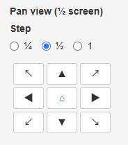
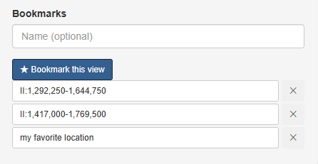
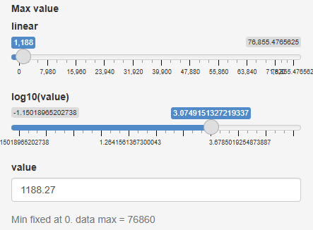

# Usage

This guide covers common tasks in HiCarta. For detailed explanations of individual controls and settings, see **[Screens & controls](interface.md)**, linked from each item.

The basic flow is: **load data → open the map → move and zoom**.

---

## Loading data

Data can be loaded from the **[data catalog](data-catalog.md)** — an Excel file with one row per sample. Click the **Data** button at the top of the screen to open the data loading dialog. It has three tabs (Data browser, Direct file and Session), and you can also enter the path or URL of a file directly.

### Load a Hi-C map {#load-hic}

1. Click the **Data** button at the top.
2. On the **Data browser** tab, load your catalog (click **Load catalog**; the field is prefilled from `config.txt`; use **Browse…** to select a local `.xlsx` file).
3. Use the sidebar filters or search to find the desired sample, and click the sample's row.
4. In the detail view, click **Open as contact map**.

→ Details: [Screens & controls - Data](interface.md#data), [Data catalog](data-catalog.md)

### Load a bigWig {#load-bigwig}

1. In the **Data browser**, click the row of a bigWig sample.
2. Click **Add as track**, adjust the label, color, and height in the dialog, and confirm.

If a Hi-C map is already open, the track is aligned with the genomic coordinates of the map.

→ Details: [Screens & controls - Tracks](interface.md#tracks)

### Tracks without a contact map {#tracks-only}

You can add tracks without opening a Hi-C map. HiCarta then **reads the chromosome
names and lengths from the first track file you add** and displays the full length of the first chromosome; the contact map stays hidden.

- Chromosome lengths are obtained from the bigWig header or estimated from the maximum coordinate in a BED / GFF3 / `*_BS.txt` file.
- Navigate from the **Navigate** panel: select a chromosome to display its full length, enter the start and end coordinates, and click **Go to region**, pan with the left/right buttons, and
  zoom with **+ / −**.
- If the file contains no usable chromosome information, HiCarta displays a message. In that case, open a Hi-C map first.
- If you subsequently open a Hi-C map, the contact map appears and is synchronized with the tracks.
- **Print** also supports track-only views (a coordinate axis plus the tracks).

### Load Border Strength / genes / BED {#load-bs}

As with other tracks, register the file in the catalog (set `file_type` to `bs`, `gff3`, or `bed`, or let HiCarta infer the type from the extension), click the row in the **Data browser**, and choose **Add as track**.

Border Strength (`*_BS.txt`): positive values are drawn in red, negative values in blue, and boundaries are marked with dashed lines. For the file formats, see **[Data formats](data-formats.md)**.

→ Details: [Screens & controls - Tracks](interface.md#tracks)

---

## Navigating the displayed region

Navigation controls are available in the **Navigate** panel on the left of the screen.

### Move to any location {#goto}

1. Choose **Navigate** in the top menu.
2. Choose a **Chromosome (X axis)**, and enter the range you want in **X-axis start** and **X-axis end** (bp). For an inter-chromosome map, also set the Y-axis chromosome and range.
3. Click **Go to region**.

→ Details: [Screens & controls - Navigate](interface.md#navigate)

### Move with buttons {#pan}

Use the direction pad in the **Navigate** menu (up/down/left/right plus diagonals) to move the map. Set the movement per click using **Step** (¼ · ½ · 1 screen). You can also drag the map to pan or scroll to zoom.

→ Details: [Screens & controls - Navigate](interface.md#navigate)

### Show the whole chromosome {#whole}

Click the button in the center of the direction pad (⌂) in the **Navigate** menu to return to the whole-chromosome view.

→ Details: [Screens & controls - Navigate](interface.md#navigate)

### Bookmark a region of interest {#bookmark}

1. Display the region you want to bookmark.
2. Optionally, enter a bookmark name in the field at the bottom of the **Navigate** panel.
3. Click **★ Bookmark this view**.

Saved bookmarks appear in a list. Click a bookmark to return to the corresponding genomic region. Bookmarks record only genomic locations, allowing you to revisit the same region across samples. The current normalization, resolution, and color scale remain unchanged. To remove an unwanted bookmark, use **Delete**. **Save to Excel** / **Load from Excel (append)** allow you to export or import the bookmark list as an `.xlsx` file that you can annotate and share ([details](data-catalog.md#bookmarks-as-excel)).

→ Details: [Screens & controls - Navigate](interface.md#navigate)

---

## Adjusting the appearance

### Change the contrast (color intensity) {#contrast}

Choose **Display** in the top menu and drag the **Max value** slider to change the contrast. Switching between **linear / log10** and choosing a **Palette** are also done here.

→ Details: [Screens & controls - Display](interface.md#display)

### Adjust map height and layout {#layout}

In **Setting** in the top menu, you can set the **Contact map height**, adjust the map to fit the available window height with **Fit to window**, and adjust track heights and resolution.

→ Details: [Screens & controls - Setting](interface.md#setting)

---

## Saving and exporting

### Save the view and reproduce it later (session) {#session}

**To save:**

1. Open the **Data** button → **Session** tab.
2. Click **Save current view** to download a `.json` file.

**To restore:**

1. Open the **Data** button → **Session** tab.
2. In **Restore from file (.json)**, select the saved `.json` file and click **Load**.

The data sources, genomic region, color scale, tracks, and other saved settings are restored together. The original data files must still be accessible.

→ Details: [Screens & controls - Data (Session)](interface.md#data)

### Export a figure / print {#print}

1. Open the map you want to export.
2. Choose **Print** in the top menu and click **Open print preview**.
3. In the preview, set the destination (Printer / File), format (PNG / PDF), paper size, output region, whether to include coordinate ticks, the legend and margins, and whether to include tracks.
4. Click **Run**.

→ Details: [Screens & controls - Print](interface.md#print)

---

## Other

### Switch the display language {#language}

Open **Setting → Edit config file…** in the top menu, choose the **Interface language**, and click **Apply & save**. The page reloads and the language switches. Because changing the language closes the currently open map and tracks, use the [session save feature](#session) if you want to return to the same state.

→ Details: [Screens & controls - Setting](interface.md#setting)
