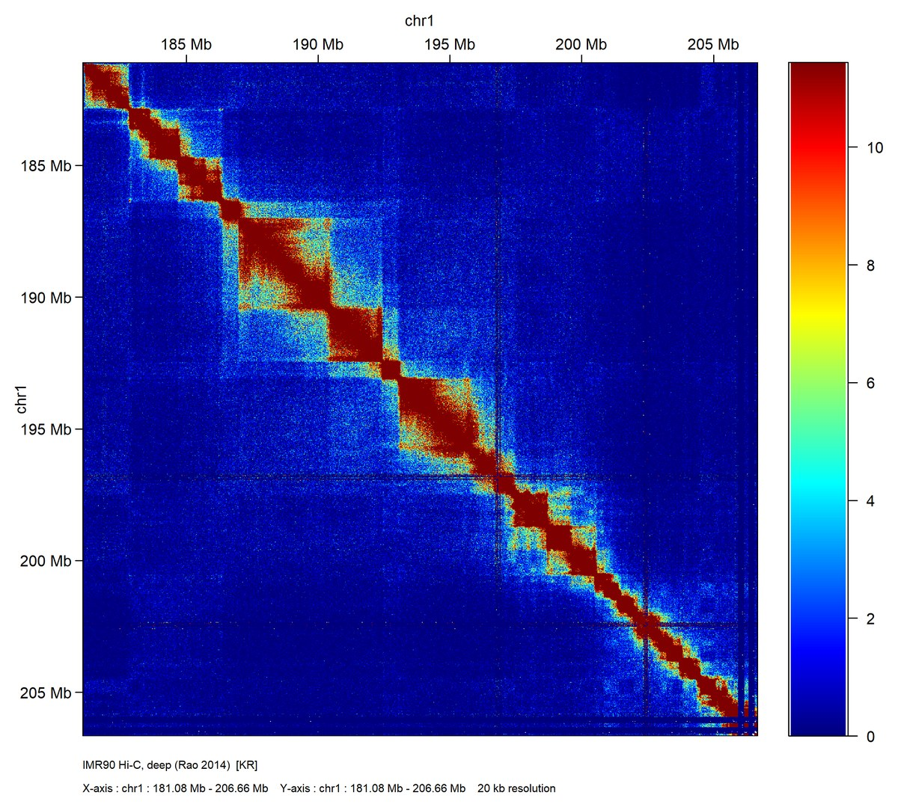
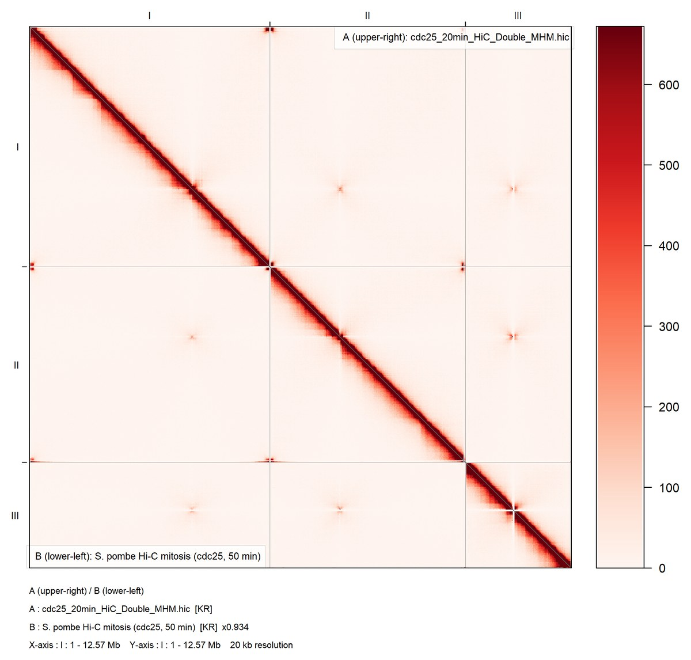
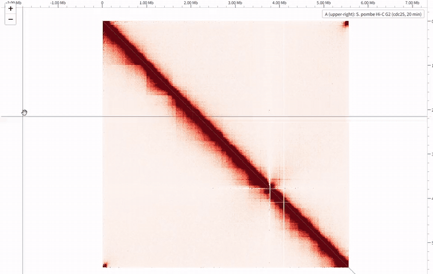
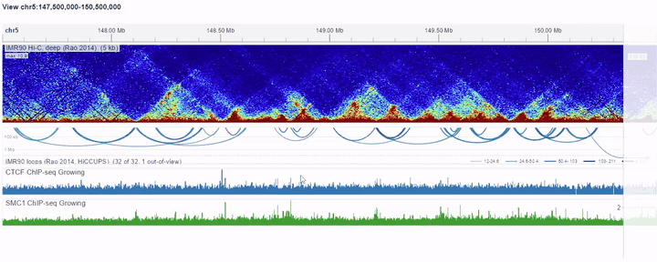
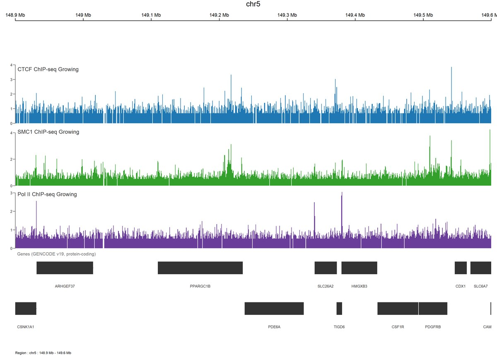
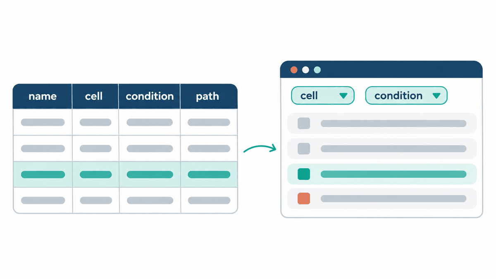
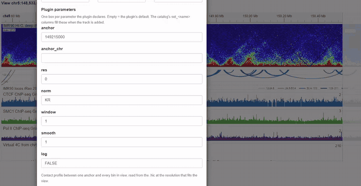
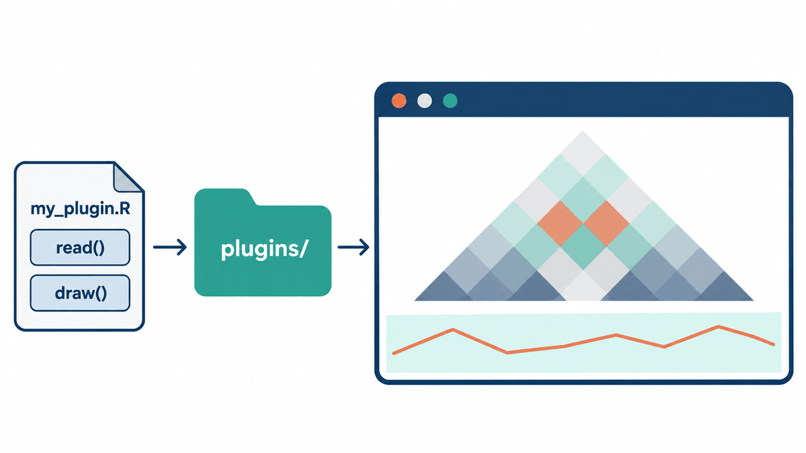
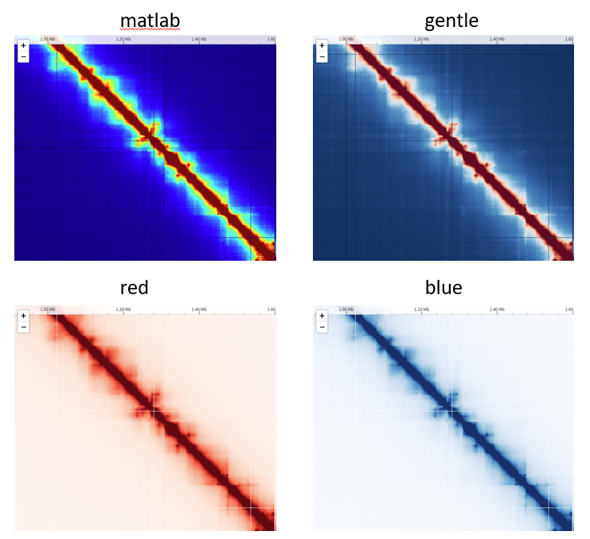

# HiCarta でできること

HiCarta の機能を、画像と短い動画で紹介します。各項目の具体的な操作手順は、**[使い方](usage.md)** と **[画面と操作の説明](interface.md)** の該当箇所にリンクしています。このページに掲載した図と動画は、すべて **[デモデータ](demo-data.md)**（公開データ）を HiCarta で表示したものです。

---

## 地図アプリのように操作する

ドラッグで表示領域を移動し、スクロールで拡大・縮小できます。解像度は拡大率に応じて自動的に切り替わり、染色体全体から数 kb の領域まで連続的に閲覧できます。Hi-C マップの表示に必要な部分のデータだけを読み込むため、高解像度のマップや大きなゲノムでも軽快に動きます。

- **任意の場所へ移動** — 染色体と範囲を入力して、見たい領域へ移動できます。→ [任意の場所に移動する](usage.md#goto)
- **ボタンで移動** — 8 方向のボタンで、マップを一定の移動量で動かせます。→ [ボタンで移動する](usage.md#pan)
- **ブックマーク** — 注目している領域に名前を付けて保存し、1 クリックで戻れます。記録されるのはゲノム上の位置だけなので、サンプルを切り替えてから同じブックマークをクリックすれば、そのサンプルの同じ領域が見られます。Excel との入出力もできます。→ [気になる場所をブックマークする](usage.md#bookmark)

### ゲノム全体と染色体間の相互作用を見る

{ width="500" }

縦横の両軸に全染色体を並べ、すべての染色体の組み合わせを一度に表示できます。任意のブロックにズームインできます。縦軸に別の染色体を指定して、2 本の染色体の間の相互作用（trans）だけを表示することもできます。→ [マップ上を移動する](interface.md#navigate)

---

## 異なる条件の Hi-C マップを比較する

2 つ目のサンプルを開くと、異なる条件の Hi-C マップを同じ画面で比較できます。比較の方法は 3 種類です。

| 表示 | 内容 |
|---|---|
| **対角分割（split）** | 対角線を境に、右上にサンプル A、左下にサンプル B を表示します。 |
| **カーテン（curtain）** | 仕切りをドラッグすると、左右でサンプルが切り替わります。スペースキーで、マップ全体を A と B で瞬時に切り替えることもできます。 |
| **差分マップ（difference）** | 2 つのマップの比の log2 値または差を、0 を中央色とする対称なスケールで表示します。色覚に配慮したパレットも選べます。 |

自動補正を有効にすると、サンプル間のシーケンス深度の違いを総コンタクト数の比に基づいて補正します。→ **[チュートリアル：2 つの条件を比較する](tutorial-compare.md)**

---

## Hi-C マップとさまざまなゲノムデータを同時に表示する

Hi-C マップの下に、次のトラックを並べて表示できます。トラックの表示位置は Hi-C マップと連動するため、同じゲノム領域の情報を比較できます。

| トラック | 内容 |
|---|---|
| **回転マップ（RotMap）** | Hi-C マップを 45 度回転させた三角形のトラック。距離の範囲、向き、色、正規化、O/E を設定できます。 |
| **ループ（弧）** | BEDPE、HiCCUPS のループ一覧、ChIA-PET／HiChIP の表を弧として表示します。相互作用の強さに応じて色と太さを変えられます。 |
| **シグナル** | bigWig（ChIP-seq など）。トラックごとに描画の解像度を変えられます。 |
| **ゲノム区間・遺伝子** | BED、GFF3 |
| **ドメイン境界強度** | Border Strength（`*_BS.txt`） |

- **トラックだけを表示する** — 正方形の Hi-C マップを隠して、回転マップと各トラックだけを並べられます。Hi-C マップを開かずに、トラックだけを表示することもできます。→ [Hi-C マップなしでトラックだけ見る](usage.md#tracks-only)
- **見た目の調整** — トラックごとに名前、色、高さ、最大値・最小値を設定できます。チップをドラッグすると並び順が変わります。→ [トラック](interface.md#tracks)

---

## Excel ファイル 1 つでサンプルを管理する

{ width="600" }

専用のデータベースを構築する必要はありません。Excel に 1 行につき 1 サンプルの情報を記載するだけで、データカタログを作成できます。細胞種、実験条件、抗体などの項目は、列として自由に追加できます。異なる値が 20 個以下のカラムは絞り込み用のフィルタとして利用できるため、数百のサンプルから目的のデータを数クリックで探し出せます。同じ Excel ファイルを共同研究者と共有すれば、共通のデータカタログを利用できます。→ **[データカタログ](data-catalog.md)**

---

## 未発表データを安全に共有する

{ width="600" }

Amazon S3 に保存したファイルにアクセス制御用のタグを付け、タグに応じたアクセス権限を設定することで、許可されたユーザーだけがファイルを閲覧できるようにします。タグに応じたアクセス権限をあらかじめ設定しておけば、論文の公開時などに共有範囲を広げる際も、タグの変更だけで対応できます。ファイルを移動する必要はなく、Excel に記載したファイルのパスもそのまま利用できます。→ [非公開の S3 データを読む](data-catalog.md#private-data-on-amazon-s3)

---

## R で独自の描画機能を追加する（プラグイン）

HiCarta が標準で提供する描画機能に加え、R で独自のトラックを作成できます。プラグインは、`read()` と `draw()` の 2 つの関数を記述した R スクリプトファイル 1 つです。このファイルを `plugins/` フォルダに置くと、新しい種類のトラックとして利用でき、設定画面も自動的に生成されます。カタログからの読み込み、セッションの保存・復元、図の出力にも対応しています。`chr`、`start`、`end`、`value` のカラムを持つ表を描画するプラグインと、`.hic` から読む Virtual 4C のプラグインを同梱しています。→ **[プラグイン](plugins.md)**

{ width="600" }

---

## 論文用の編集可能な図を出力する

印刷プレビューで出力イメージを確認しながら、図に含める要素（座標目盛、凡例、トラック、サンプル情報など）を調整できます。PDF 出力では、Hi-C マップをラスター画像として、軸・ラベル・トラックなどを編集可能なベクター形式で保存します。ファイルサイズを抑えながら、Illustrator や Inkscape などで編集できる図を作成できます。PNG での出力や、プリンターへの直接出力もできます。→ **[チュートリアル：論文用の図を作る](tutorial-figure.md)**

---

## 既存のデータファイルをそのまま利用する

{ width="600" }

`.hic` ファイルや各種トラックのデータを、ローカルの PC、Web サーバー、Dropbox の共有リンク、Amazon S3（公開・非公開）から開けます。

- **必要な部分だけを読み込む** — リモートの `.hic` と bigWig は、表示領域に必要な部分だけを HTTP レンジリクエストで取得します。ファイル全体をダウンロードする必要はありません。
- **閲覧済みの領域を高速に表示する** — 読み込んだデータはメモリにキャッシュされるため、一度閲覧した領域に戻るときは高速に表示されます。
- **通信が遅い環境では** — 設定で、ファイル全体を先にローカルに保存してから描画するモード（`hic_engine = download`）に切り替えられます。
- BED、GFF3、Border Strength のファイルは、最初にファイル全体を読み込みます。

→ **[HiCarta のしくみ](how-it-works.md)**

---

## そのほかの機能

- **カラースケールの調整** — 4 つのカラーパレット（matlab、gentle、red、blue）から選び、最大値を線形または log10 のスライダーで調整できます。→ [色の濃さ（コントラスト）を変える](usage.md#contrast)

    

- **正規化と解像度の切り替え** — 開いたマップの正規化（KR、ICE、Raw など）と解像度を、開き直さずに切り替えられます。→ [表示](interface.md#display)
- **セッションの保存** — データ、領域、カラースケール、すべてのトラックを含む表示全体を 1 つのファイル（`.json`）に保存し、後で表示状態を復元できます。→ [表示状態を保存して後で再現する](usage.md#session)
- **IGV で開く** — カタログのサンプルを、起動中の IGV に送れます。→ [IGV で開く](data-catalog.md#open-in-igv)
- **表示言語の切り替え** — インターフェースの言語を、日本語と英語で切り替えられます。→ [表示言語を切り替える](usage.md#language)
