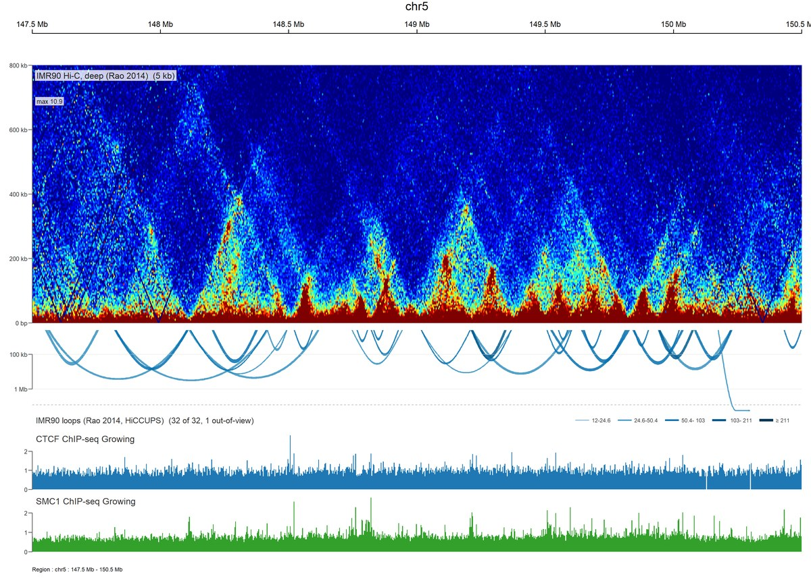

# はじめての 5 分

公開データを集めた**デモカタログ**を使って、HiCarta の基本操作を試してみましょう。**カタログの読み込み → Hi-C マップの表示 → 移動・ズーム → トラックの追加 → ブックマークによる移動 → 図の出力** の 6 ステップで進めます。

データはすべてインターネット上にあるため、事前にダウンロードする必要はありません。HiCarta は `.hic` や bigWig から表示領域に必要な部分を読み込みます。

!!! note "準備"
    HiCarta をインストールして起動しておいてください（**[インストール](install.md)**）。インターネットへの接続が必要です。

## 1. デモカタログを読み込む {#load-catalog}

1. 画面上部の **データ** をクリックします。
2. **データブラウザ** タブの「カタログ (.xlsx) のパスまたは URL」の欄に、次の URL を貼り付けます。

    ```
    https://uo-cgf.s3.us-west-2.amazonaws.com/HiCarta/demo/HiCarta_demo_catalog.xlsx
    ```

3. **カタログを読み込む** をクリックします。

サンプルの一覧が表示されます。左側のフィルタを使い、生物種（`organism`）や実験の種類（`experiment_type`）などの項目で一覧を絞り込めます。カタログの中身は **[デモデータ](demo-data.md)** を参照してください。

## 2. Hi-C マップを開く

1. 一覧で **IMR90 Hi-C, deep (Rao 2014)** の行をクリックします。
2. 表示された詳細画面で **コンタクトマップとして開く** をクリックします。

ヒト IMR90 細胞の高深度 Hi-C マップ（Rao *et al.*, 2014）が開きます。

## 3. 移動とズーム

- **ドラッグ**で移動し、**マウスのホイール**で拡大・縮小します。解像度は拡大率に応じて自動的に切り替わります。
- 見たい領域に直接移動するには、左の **移動** パネルで X 軸の染色体に `chr5` を選び、開始座標に `147500000`、終了座標に `150500000` を入力して **領域へ移動** をクリックします。
- 色が薄い（濃い）ときは、**表示 → マップ** の **最大値** で調整します。

この領域では、マップ上に、ループに対応する点状のシグナルがいくつも見えます。

## 4. トラックを重ねる

**データ** からデータブラウザに戻り、次の行を順にクリックして、**トラックとして追加** をクリックします。追加する前に、ラベル・色・高さを調整できます。

| 行 | 表示されるもの |
|---|---|
| **IMR90 loops (Rao 2014, HiCCUPS)** | ループを弧として表示 |
| **CTCF ChIP-seq Growing** | CTCF の ChIP-seq シグナル |
| **SMC1 ChIP-seq Growing** | コヒーシンの構成因子 SMC1 の ChIP-seq シグナル |
| **Genes (GENCODE v19, protein-coding)** | 遺伝子 |

さらに、**IMR90 Hi-C, deep (Rao 2014)** の行で **回転マップとして追加** をクリックすると、Hi-C マップを 45 度回転させた三角形のトラックとして表示できます。トラックの表示位置は Hi-C マップと連動します。



!!! tip "見やすくするには"
    - トラックの設定は、**表示 → トラック** に並んだトラックの名前をクリックすると変更できます。CTCF は最大値を 6、SMC1 は 8 程度にすると、ピークが見やすくなります。
    - ループのトラックでは、「距離の上限 (bp)」を `2000000`（2 Mb）にすると、この領域のループを表示できます。
    - 正方形の Hi-C マップを隠して回転マップとトラックだけを表示するには、**表示 → マップ** の **コンタクトマップを隠す（トラックのみ）** を使います。

ループの両端（アンカー）と CTCF や SMC1 のピークとの位置関係を確認できます。

## 5. ブックマークで移動する

ダウンロードした HiCarta のフォルダの `sample/HiCarta_demo_bookmarks_hg19.xlsx` に、デモ用の領域と、老化に関わる遺伝子（SASP 遺伝子）のブックマークを用意しています。

1. **移動** パネルのブックマーク欄を開き、**Excel から読み込み（追加）** の欄で **参照…** からこのファイルを選び、**読み込む** をクリックします。
2. 一覧から **PDGFRB / CSF1R (chr5)** をクリックすると、その領域に移動します。

ブックマークにはゲノム上の位置だけが記録されます。別のサンプルを開いても、同じブックマークで同じ領域に移動できます。

## 6. 図として出力する

1. 画面上部の **印刷** を開き、**印刷プレビューを開く** をクリックします。
2. 送信先を **ファイル**、フォーマットを **PDF** にして、出力フォルダとファイル名を指定します。
3. **トラックも出力する** がオンになっていることを確認して、**実行** をクリックします。

PDF では、Hi-C マップはラスター画像として、軸・ラベル・トラックは編集可能なベクター形式で保存されます。詳しくは **[論文用の図を作る](tutorial-figure.md)** を参照してください。

---

## 次に読むページ

- **[2 つの条件を比較する](tutorial-compare.md)** — デモカタログの分裂酵母の G2 期と分裂期の Hi-C マップを比較します。
- **[データカタログ](data-catalog.md)** — 自分のデータを使うためのカタログの書き方です。`sample/HiCarta_catalog_template.xlsx` をコピーして使えます。
- **[できること](features.md)** — HiCarta の機能の一覧です。
