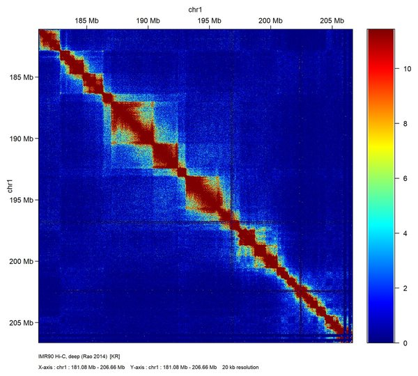
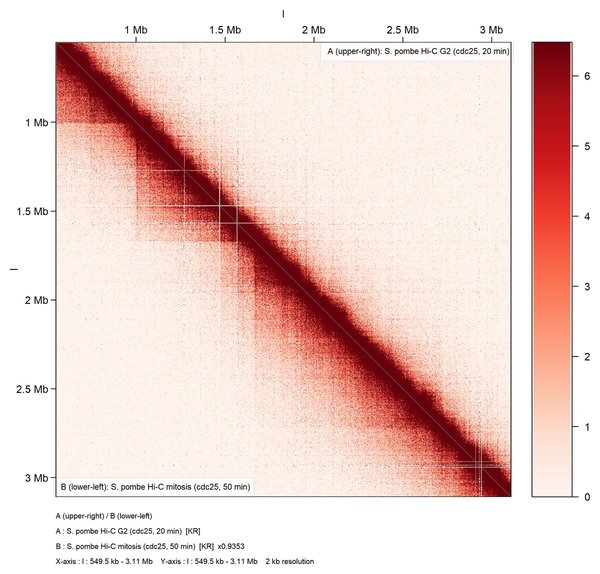
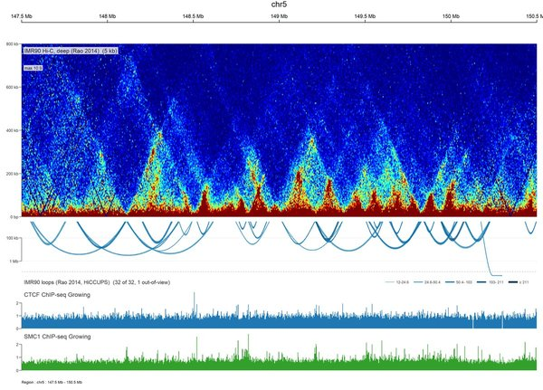
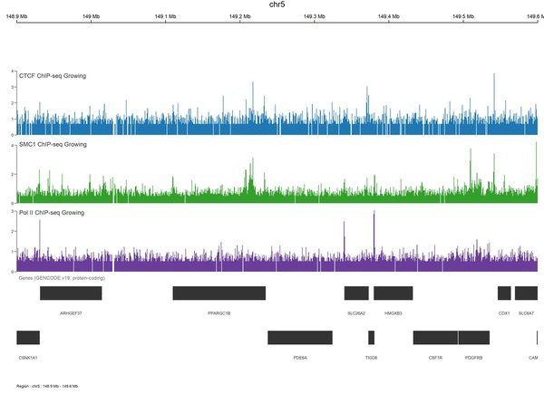
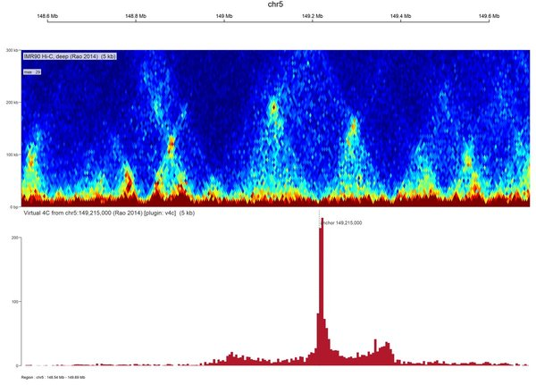
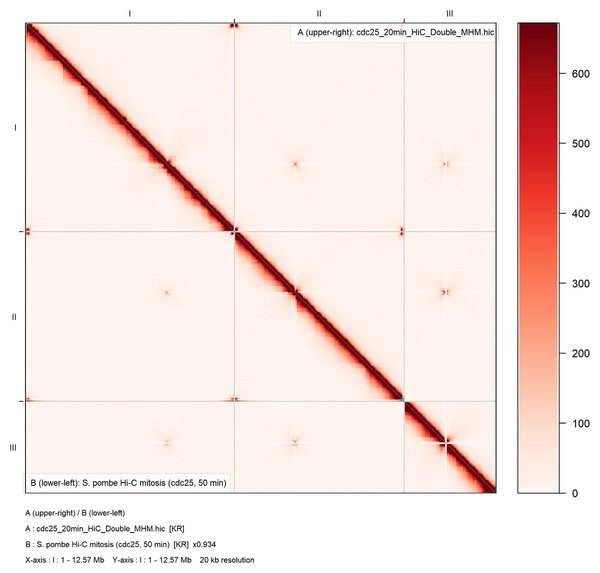

# HiCarta

**Hi-C マップを、地図アプリのように。**

HiCarta は、Hi-C データを可視化する無料のデスクトップアプリです。複数の染色体を俯瞰する全ゲノム表示から個々の遺伝子のスケールまで、ドラッグとスクロールで自由に移動・拡大・縮小できます。ループや ChIP-seq などのトラックの同時表示、異なる条件の Hi-C マップの比較、R による独自の描画機能の追加、論文用の編集可能な図の出力にも対応しています。

お使いの PC 上で動作し、専用サーバーの構築は不要です。R をインストールしておけば、ダブルクリックで起動できます。名前の「Carta」は、イタリア語やラテン語で「地図・海図」を意味します。

<iframe src="https://www.youtube-nocookie.com/embed/C0b3ExIoMVM" title="HiCarta demo (4 min)" style="position:absolute; top:0; left:0; width:100%; height:100%; border:0;" allow="accelerometer; encrypted-media; gyroscope; picture-in-picture" allowfullscreen></iframe>

4 分のデモ動画です（[1 分の紹介](https://youtu.be/emcjmTKh6gQ) もあります）。

## 可視化の例

| | | |
|:---:|:---:|:---:|
|  **Hi-C マップ** |  **2 条件の比較（右上と左下に分割表示）** |  **回転マップ＋ループ＋ChIP-seq** |
|  **ChIP-seq トラック＋遺伝子** |  **R によるカスタムトラック** |  **複数の染色体を同時表示** |

上の図はすべて HiCarta から PDF として出力したものです。各機能の説明は **[できること](features.md)** を参照してください。

## 目的から探す

- :material-rocket-launch: **[はじめての 5 分](first-5-minutes.md)** — 公開データを使って、マップの表示からトラックの追加、図の出力までを試す
- :material-download: **[インストール](install.md)** — Windows・macOS でのインストールと起動
- :material-compare: **[2 つの条件を比較する](tutorial-compare.md)** — 対角分割・カーテン・差分マップの 3 種類の比較表示
- :material-file-pdf-box: **[論文用の図を作る](tutorial-figure.md)** — 印刷プレビューから PDF を出力し、Illustrator などで仕上げる
- :material-file-table: **[自分のデータを使う](data-catalog.md)** — Excel のデータカタログの書き方
- :material-lock: **[未発表データを共有する](data-catalog.md#private-data-on-amazon-s3)** — Amazon S3 のアクセス制御を使う
- :material-puzzle: **[独自のトラックを作る](plugins.md)** — R のプラグイン
- :material-scale-balance: **[他のツールとの比較](comparison.md)** — Juicebox、HiGlass、JBrowse 2 などとの違い

## 既存のデータファイルをそのまま利用する

{ width="600" }

`.hic` ファイルや各種トラックのデータを、ローカルの PC、Web サーバー、Dropbox の共有リンク、Amazon S3（公開・非公開）から開けます。リモートの `.hic` や bigWig は必要な部分だけを読み込むため、事前にファイル全体をダウンロードする必要はありません。仕組みは **[HiCarta のしくみ](how-it-works.md)** で説明しています。

## クイックスタート

1. <https://cran.r-project.org> から R（4.1 以上）をインストールします。
2. [GitHub](https://github.com/rafysta/HiCarta) で **Code → Download ZIP** から入手し、展開します。

    { width="400" }

3. 起動します。
    - **Windows** — `run_windows.bat` をダブルクリックします。
    - **macOS** — `run_mac.command` をダブルクリックします（起動がブロックされた場合は、右クリック → 開く）。

    初回起動時は必要な R パッケージが自動的にインストールされるため、数分かかることがあります。
4. Web ブラウザに HiCarta が表示されます。続けて **[はじめての 5 分](first-5-minutes.md)** でデモデータを開いてみてください。

詳細は **[インストール](install.md)** と **[セットアップの詳細とトラブルシューティング](setup-details.md)** を参照してください。

---

開発者: **谷澤英樹（Hideki Tanizawa）**（<rafysta@gmail.com>）、北海道大学 遺伝子病制御研究所
ソース: [github.com/rafysta/HiCarta](https://github.com/rafysta/HiCarta) · MIT ライセンス
質問・不具合報告・機能のご要望は [GitHub Issues](https://github.com/rafysta/HiCarta/issues) からお知らせください。
