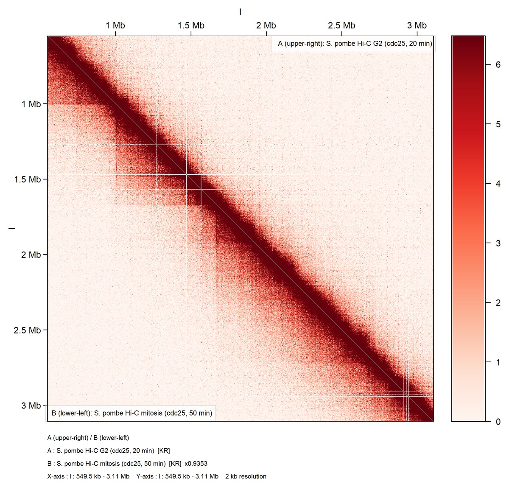
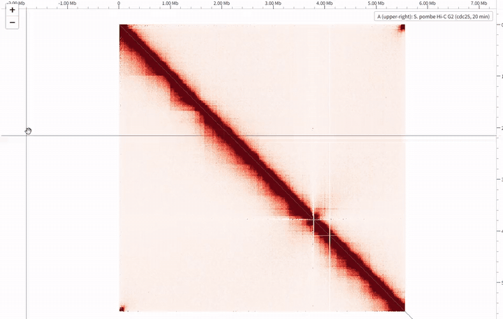

# チュートリアル：2 つの条件を比較する

2 つの Hi-C マップを同じ画面で比較する方法を説明します。例として、**[デモデータ](demo-data.md)** の分裂酵母の G2 期と分裂期の Hi-C マップを使います（Tanizawa *et al.*, *Nat Struct Mol Biol* 2017）。*cdc25-22* 変異株を同調させ、同調解除から 20 分後（G2 期）と 50 分後（分裂期）に取得したデータです。

## 1. サンプル A を開く

1. **データ** を開き、デモカタログを読み込みます（手順は **[はじめての 5 分](first-5-minutes.md#load-catalog)**）。
2. **S. pombe Hi-C G2 (cdc25, 20 min)** の行をクリックし、**コンタクトマップとして開く** をクリックします。これがサンプル A になります。
3. **移動** パネルで、第 II 染色体（`II`）を選びます。

## 2. サンプル B を開く

1. **データ** に戻り、**S. pombe Hi-C mitosis (cdc25, 50 min)** の行をクリックして、**比較 (B) として開く** をクリックします。
2. 「比較準備完了」というメッセージに、共通の解像度と、シーケンス深度の補正係数が表示されます。

比較するには、2 つのファイルが次の条件を満たしている必要があります。条件を満たさないときは、その理由が表示されます。

- 同じゲノム（染色体名と長さが同じ）であること
- 共通の解像度があること
- サンプル A で選択している正規化方法（KR など）を、サンプル B でも利用できること。両サンプルには同じ正規化方法を使用します。

## 3. 表示モードを選ぶ

**表示 → 比較** の **表示モード** で、比較の方法を選びます。

### 対角分割（split）

対角線を境に、右上にサンプル A、左下にサンプル B を表示します。同一染色体内の Hi-C マップは対角線に対して対称なので、1 枚のマップで両方の全体像を見比べられます。**対角に区切り線を描く** で、境界に線を引けます。

この例では、右上の G2 期に比べて、左下の分裂期では対角線に沿ったコンタクトシグナルの幅が広がり、大きなドメインがはっきり見えます。分裂期には、コンデンシンによって 300 kb〜1 Mb 程度の大きなドメインが形成されることが報告されています。

### カーテン（curtain）

仕切りをドラッグすると、仕切りの左右でサンプルが切り替わります。**スペースキー**（または **A / B 切替** ボタン）で、マップ全体を A と B で瞬時に切り替えられます。同じ位置で交互に切り替えると、わずかな違いに気づきやすくなります。Esc で仕切りの表示に戻ります。

### 差分マップ（difference）

2 つのマップの違いを、0 を中心とする対称なスケールで表示します。正負の値を同じ尺度で表示し、設定した範囲を超える値は両端の色で表示します。

| 設定 | 内容 |
|---|---|
| **計算式** | **log2 変化率** log2((A+ε)/(B+ε)) または **差** A − B |
| **疑似カウント ε** | コンタクト数が少ないビンで比が極端な値になるのを抑え、ゼロ除算を防ぎます。ノイズが目立つときは大きくします。 |
| **スケール上限** | 色が最も濃くなる値（± log2、または ± カウント） |
| **発散カラーマップ** | 青 − 白 − 赤、または色覚に配慮した 青 − 白 − 橙、紫 − 白 − 緑 |

疑似カウントとスケール上限の既定値は、サンプル B を読み込んだときに染色体全体から計算されます。

## 4. シーケンス深度の補正

シーケンス深度が異なるサンプルでは、マップ全体のシグナル強度が異なる場合があります。**シーケンス深度を自動補正する** がオンのとき、HiCarta は総コンタクト数の比（A / B）をサンプル B の値に掛けて補正します。係数は **B に掛ける係数** で手動でも変更できます。

差分マップを解釈する際には、シーケンス深度の違いに注意し、自動補正の設定を確認してください。この補正は総コンタクト数に基づくもので、統計的な有意差の検定ではありません。

## 5. 比較のときの注意

- **解像度** — 高解像度では 1 ビンあたりのコンタクト数が少なくなりやすく、差分マップにノイズが多くなります。違いの全体像は粗い解像度で確認し、細部は対角分割やカーテンで確認するのがおすすめです。解像度は **表示 → マップ** で固定できます。
- **カラースケール** — 対角分割とカーテンでは、A と B に同じカラースケールが使われます。
- **染色体間マップ** — 染色体間のマップには対角線がないため、対角分割は使えません。カーテンか差分マップを使ってください。
- **カーソル** — マップ上にカーソルを置くと、そのビンの A と B の値、log2(A/B)、A − B が表示されます。

## 6. 比較結果を図として出力する

比較の表示のまま **印刷 → 印刷プレビューを開く** で出力できます。**マップの下にサンプル情報を入れる** をオンにすると、対角分割表示では、サンプル A（右上）とサンプル B（左下）の情報が図に記載されます。出力の詳細は **[論文用の図を作る](tutorial-figure.md)** を参照してください。

比較をやめるときは、**表示 → 比較** の **比較を解除** をクリックします。
