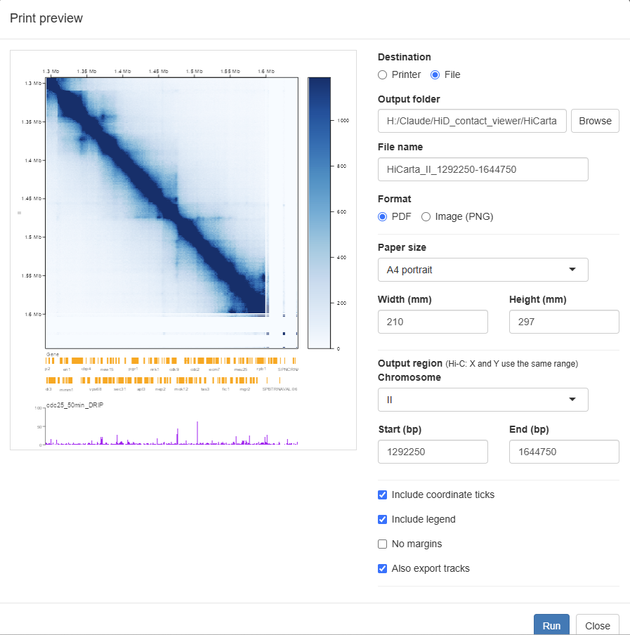

# チュートリアル：論文用の図を作る

画面に表示している Hi-C マップとトラックを、論文用の図として PDF に出力し、Illustrator や Inkscape などで仕上げるまでの流れを説明します。

PDF では、Hi-C マップはラスター画像として、座標目盛・ラベル・凡例・トラックは編集可能なベクター形式で保存されます。マップをラスター画像として保存することで、高解像度のマップでもファイルサイズを抑えられます。文字や線は後から編集できます。

## 1. 画面で図の内容を整える

図は現在の表示状態をもとに作成されます。先に画面で内容を整えておくと、プレビューでの調整が少なくて済みます。

- **領域** — 出力したい領域に移動します。正確な座標は、プレビュー画面でも指定できます。
- **色** — **表示 → マップ** で、カラーパレットと最大値を決めます。
- **トラック** — 必要なトラックを追加し、**表示 → トラック** で並び順、名前、色、高さ、最大値を整えます。トラックの名前は、そのまま図のラベルになります。
- **比較** — 2 つの条件を比べる図は、比較表示に切り替えておきます（**[2 つの条件を比較する](tutorial-compare.md)**）。

## 2. 印刷プレビューを開く

画面上部の **印刷** を開き、**印刷プレビューを開く** をクリックします。設定を変えると、プレビューがその場で更新されます。

| 設定 | 内容 |
|---|---|
| **送信先** | **ファイル** または **プリンター** |
| **出力フォルダ／ファイル名／フォーマット** | フォーマットは **PDF** または **画像 (PNG)**。編集可能な論文用の図には PDF を推奨します。 |
| **用紙サイズ** | A4 縦、A4 横、正方形、カスタム（幅と高さを mm で指定） |
| **出力領域** | 各軸の染色体、開始、終了（bp）。Y 軸に別の染色体を選ぶと、染色体間のマップを出力します。 |
| **解像度** | 「画面のマップと同じ」のままにすると、画面と同じ解像度で出力します。実際に使われた解像度は、プレビューの下に表示されます。 |
| **縦横のスケールを揃える** | 1 bp あたりの長さを縦と横で同じにします（既定でオン）。マップが歪みません。 |
| **座標目盛を入れる／凡例を入れる** | 座標目盛とカラースケールの凡例の有無を指定します |
| **余白を空けない** | マップだけを余白なしで出力します。軸やラベルを自分で描き直す場合に使います。 |
| **マップの下にサンプル情報を入れる** | サンプル名と領域、解像度を図の下に記載します。対角分割による比較図では、サンプル A（右上）と B（左下）の情報も記載されます。 |
| **トラックも出力する** | 表示中のトラックを一緒に出力します。トラックは、マップと横位置がそろうように配置されます。 |

## 3. 出力する

設定が完了したら **実行** をクリックします。保存したファイルの場所がメッセージに表示されます。プレビュー画面は開いたままなので、領域や設定を変えて続けて出力できます。

## 4. Illustrator や Inkscape で仕上げる

出力した PDF を Illustrator や Inkscape で開くと、座標目盛、ラベル、凡例、トラックの線や塗りを、それぞれ選択して編集できます。

- フォントの種類や大きさ、線の太さ、色を、投稿先の学術誌の規定に合わせて変更できます。
- Hi-C マップはラスター画像です。マップとトラックをまとめて拡大・縮小すれば、両者の位置関係を保てます。
- 複数の領域や条件の図を並べるときは、同じ設定（用紙サイズ、解像度、最大値）で出力しておくと、図のサイズとカラースケールを統一しやすくなります。

!!! tip "スライドやポスター用には"
    フォーマットを **画像 (PNG)** にすると、そのまま貼り付けられる画像として出力できます。

## 5. 同じ図を後で作り直す

**セッション** を保存しておくと、データの参照先、領域、カラースケール、トラックなどの表示状態を後で復元できます。査読のあとで図を作り直すときに便利です。→ [表示状態を保存して後で再現する](usage.md#session)
